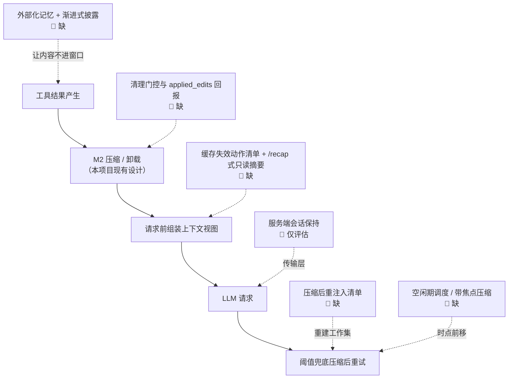

# Agent 上下文压缩分层 —— 市面对照与演进记录（四层按需机制之外）

> **文档性质（一开口就讲清）**：本文**不是现状说明书，也不是已拍板的设计**，而是一次架构评审的对照记录——把 Claude Code（下称 CC）"Snip / MicroCompact / Collapse / AutoCompact 四层按需压缩"放进 2025–2026 市面成熟做法里对照，指出**哪些该保留、哪些已有更优解、演进方向是什么**。所有标注"改 / 补 / 演进"的条目均为 **📐 演进方向（尚未落地、未拍板）**，落地前需按 §6 分档逐项确认。
>
> **底座口径**：AgentScope 2.0（Python，版本要求以 ADR 为准）。框架提供 `Offloader` / `ToolOffloadMiddleware`（上下文压缩与超大结果卸载）与 `Model` 抽象，**不提供 `compact` / `Handoffs` / `Routing` / `Pipeline` / `MsgHub` 原语**（见 [Agent记忆系统-设计与实现方案.md](Agent记忆系统-设计与实现方案.md) 文首、[ADR-01/ADR-13](../架构设计v2/00-架构决策记录ADR.md)）。本文所有"压缩分层 / 折叠 / 摘要"一律指**应用层实现**，不是框架能力；`OffloadCompactPolicy` / `ResultCompactor` 一类是本项目内部封装命名。
>
> **第三方口径**：文中 `Claude Code` / `Claude Developer Platform` / `Context Editing` / `Memory Tool` / `Message Threads` / `Mem0` / `Letta` / `Zep` / `Context-Folding` / `RE-TRAC` 等均为**市面第三方方案或研究成果，非本仓库已引入依赖**，引用仅为对照，不代表选型承诺。**`Snip` / `MicroCompact` / `Collapse` / `AutoCompact` 是特定版本与特性开关下的实现观察，不是对外 API 契约**（见 §8）。
>
> **口径纪律**：全篇是**设计规划 / 市面对照**，不说"已落地降本 X%"。官方评测数字一律标注"官方自有评测集口径"，本项目收益 🔴 待实测；沿用 [AgentToken成本优化-设计与实现方案.md](AgentToken成本优化-设计与实现方案.md) 文首"绝不编业务效果数字"与 [项目亮点与指标卡片.md](../面试指南/项目亮点与指标卡片.md) §0。面试侧展开见 [Agent上下文管理-面试闪光点与答辩话术.md](../面试指南/Agent上下文管理-面试闪光点与答辩话术.md)。
>
> **与既有文档的关系（避免重复）**：
>
> | 既有文档 | 讲了什么 | 本文补什么 |
> |---|---|---|
> | [Agent记忆系统-设计与实现方案.md](Agent记忆系统-设计与实现方案.md) §4 | M2 上下文窗口记忆：`Offloader` 压缩、"模型看摘要 / trace 落全文"双路 | 补：**压缩不是一层，是按成本递增的四层按需管线**；补压缩后"重建工作集"、渐进式披露、缓存安全操作 |
> | [AgentToken成本优化-设计与实现方案.md](AgentToken成本优化-设计与实现方案.md) §6–7 | prompt cache 分层与 TTL、`ResultCompactor` 字段裁剪、成本归因 | 补：**缓存对齐的可配置门控**（`keep` / `clear_at_least`）、缓存失效动作清单、清理量回报 |
> | [Agent路由与多轮上下文-市面对照与演进方向.md](Agent路由与多轮上下文-市面对照与演进方向.md) | 路由与 **M0 对话侧记忆**的市面对照、档 0/1/2 | 补：**执行侧上下文压缩**的对照；两篇并列，一个管"送到哪个能力门口"，一个管"进门后模型看多少" |
> | [FactoryAgent-研究报告生成flow.md](FactoryAgent/FactoryAgent-研究报告生成flow.md) §6–7 | 子 Agent 四层解法、单次 tool ≤5k、父会话 40~50k 触发压缩 | 补：官方 2026 年对"少用子 Agent、改用渐进式披露"的**反向修正**与判据 |
> | [整体技术选型与模块划分.md](../整体技术选型与模块划分.md) §4 | 三层路由 + 能力装配全景、五层杠杆优先级 | 补：传输层（服务端会话保持）这一**五层之外的新维度** |

---

## 0. 先界定：这篇回答的不是"怎么把摘要做得更狠"

一句话核心判断：

> **2026 年的增量不在"更强压缩"，而在压缩被摊到了五个新维度上：可配置化、时点前移、压缩后重建、外部化 / 渐进披露、传输层。**

因此本文的对照方法不是"四层 vs 某个更优算法"，而是**逐层问"这一层解决不了的下一个问题是什么"**：

| 四层机制的遗留问题 | 2026 市面给出的答案 |
|---|---|
| 清理是 CLI 内部实现，开发者不能配、不能观测 | 平台级 `Context Editing`：策略可配 + `applied_edits` 回报 |
| 只在临界点触发，而此刻模型"最不聪明" | 空闲压缩 / 带焦点压缩 / 自定义水位 / `rewind` 回退 |
| 摘要是唯一信息载体，压缩完容易丢配置与工具状态 | 压缩后**从磁盘重注入** + 按需重载 + 受预算重读 |
| 只会"进来再压"，没管"别让它进来" | 外部化记忆 + 工具 / 技能 / 规则的渐进式披露 |
| 只处理"发给模型的内容"，没处理"怎么送过去" | `Message Threads`：服务端保留会话，每轮只发增量 |

---

## 1. 基线复盘：CC 四层按需压缩（对照的锚点）

### 1.1 四层总览

| 层 | 触发 | 作用对象 | 是否调 LLM | 同步 / 异步 | 保真度 |
|---|---|---|---|---|---|
| **Snip** | 出现已消费的大块旧工具结果 | 消息序列中的工具结果 | 否 | 同步 | 标记化替换 |
| **MicroCompact** | 请求前 + 时间间隔 / 缓存状态满足 | 符合条件的旧工具结果（保留近期） | 否 | 请求链路内同步 | 局部有损 |
| **Collapse** | **特性启用** + 存在稳定低风险片段 | 本轮上下文视图的中段 | 子 Agent 局部摘要 | 异步准备 + **同步应用** | 局部有损 |
| **AutoCompact** | 接近预算上限 / 请求溢出 | 整段历史 | 优先不调，兜底才调 | 触发时同步 | 全局有损 |

### 1.2 门控，不是流水线

```text
每轮请求前（示意，非源码）：
  if 存在已消费的大块旧工具结果:  snip()                  # L1 成本近 0
  if 满足时间/缓存条件:            microcompact()        # L2 条件不成立整层跳过
  if feature_enabled and 有稳定片段: apply_ready_collapses()  # L3 多一道特性开关
  send()
  if 预估超预算 / 溢出:            auto_compact(); retry()   # L4 临界或失败后兜底
```

四层**各自有独立门控**，可以只跑 L1、可以 L1+L2、也可以直接跳到 L4；Collapse 还取决于相关特性是否启用。三条可迁移的原则：

1. **结构完整性是硬约束**：Snip 替换旧结果时必须保留消息结构以及 `tool_use` / `tool_result` 配对——这是请求合法性底线，不是审美问题。
2. **缓存状态是"何时压"的一等输入**：缓存还热时改前缀会让已缓存部分作废；缓存已过期、本次本来就要重算时顺手清理，边际成本近零，且减小后续每轮基线体积。
3. **视图 / 记录分离**：Collapse 的原始记录仍在 transcript，改变的只是本轮模型看到的上下文视图——可回退、可重放、可审计。

> AutoCompact 两条策略：优先用后台维护好的 **Session Memory**（已有摘要 + 近期原文，临界点不再额外调 LLM）；不适用或失败时走 **Full LLM Compact**，产出含核心请求、涉及文件、错误与修复、待办、当前工作、下一步的结构化摘要。

---

## 2. 2026 市面增量总览

| 增量 | 补上四层的哪个缺口 | 出处 / 时点 |
|---|---|---|
| Context Editing（平台级清理策略） | Snip/MicroCompact 从隐式实现 → 显式、可配、可归因 | Anthropic 2025-09-29 |
| Memory Tool（文件式外部记忆） | 关键信息根本不进窗口 | 同上 |
| idle compaction / 带焦点压缩 / 自定义水位 / rewind | AutoCompact 只在临界点触发的质量问题 | Claude Code 2026 |
| 压缩后重注入清单 | Full LLM Compact 只讲摘要模板，没讲摘要之外怎么重建工作集 | 官方 `context-window` 文档 |
| 渐进式披露 + 折回子 Agent | 对 Collapse"交给子 Agent 做局部摘要"的反向修正 | 官方 2026-10-22 |
| 缓存失效清单 + `/recap` 类缓存安全操作 | 只按缓存状态挑时点，缺全链路"哪些动作毁缓存"约束 | 官方 `prompt-caching` 文档 |
| Message Threads | 四层改"发给模型的内容"，这一层改"怎么送过去" | Messages API 2026-11-02 beta |
| Context-Folding / RE-TRAC | 折叠由 harness 被动挑片段 → 模型主动管理；摘要记"死路" | ICML 2026 |

---

## 3. 逐项详解

### 3.1 压缩变成平台 API：把 L1/L2 交给你配置

官方把上下文管理拆成三个积木：**server-side compaction 为主**（多数场景）、**context editing** 用于细粒度控制、**客户端 SDK compaction** 作备选。`clear_tool_uses_20250919` 的配置项几乎是 L1/L2 的显式化：

| 配置项 | 默认 / 语义 | 对应基线的哪一层 |
|---|---|---|
| `trigger` | 默认 100000 输入 token，也支持按 `tool_uses` 计 | L2 的"请求前门控" |
| `keep` | 默认保留最近 3 次 use/result 对 | L2 的"保留近期结果" |
| `clear_at_least` | 清不掉指定 token 数就**干脆不清** | **L2 缓存权衡的旋钮**：判断"为清理而打断提示缓存是否值得" |
| `exclude_tools` | 重要工具永不清理 | L1 的"低价值内容"判别显式化 |
| `clear_tool_inputs` | 默认 `false`：只清结果、保留原始调用 | L1 的"保留工具调用 / 结果对应关系" |

另有 `clear_thinking_20251015` 清理早期思考块（可选保留最近的）。响应返回 `applied_edits.cleared_tool_uses` / `cleared_input_tokens`——**清理量可观测、可归因**，这是本项目 `ResultCompactor` 目前没有的一层。官方也明确提示"前缀包含工具时，工具清理会使缓存失效"。

**Memory Tool** 是纯客户端文件目录（`/memories`），跨会话持久、存储后端由应用自管。它与清理是一对：**清理丢弃噪声，记忆把有价值的洞察搬出窗口**。官方自有评测集口径：memory tool + context editing 组合较基线 **+39%**，context editing 单独 **+29%**；100 轮 web search 评测 token **−84%** 且完成了本会因上下文耗尽而失败的工作流。🔴 这些是官方评测集数字，本项目收益待实测。

### 3.2 时点前移：不要等到临界点才压缩

官方 2026-04 会话管理文章直接点名**"坏 autocompact"的根因**：压缩发生在上下文最长、context rot 最严重时，模型此刻最不聪明，且无法预测下一步方向，容易把"顺手看到的那个 warning"丢掉。

| 手段 | 机制 | 对基线的改进 |
|---|---|---|
| `idleCompaction` | 长会话空闲且用 1h TTL 时，可能在空闲期压缩（`false` 可关，v2.1.290+） | 把开销挪出关键路径 |
| `/compact focus on ...` | 带指令压缩，人工指定保留什么 | 补上"模型猜不准方向" |
| `/autocompact 500k`、`/context`、`/usage` | 自定义水位 + 实时占用可视化 | 阈值不再是黑盒 |
| `/rewind` + "summarize from here" | 只总结一段分支，产出"写给上一版自己的交接说明" | 局部折叠可人工触发 |
| 任务间歇手动 `/compact` | 官方明确建议：**别等任务中途自动触发** | 缓存温热时摘要请求读前缀，成本远低于上下文大小的暗示 |

两个成本细节值得抄进本项目：缓存已过期的旧会话恢复时压缩成本最高；若整条路径想丢弃，`/rewind` **截断回一个已缓存前缀**，比 `/compact` 构建全新前缀更省。

### 3.3 压缩后不是只剩摘要，而是"重建最小工作集"

官方 `context-window` 文档给出压缩后各类内容的处置表，比"结构化摘要 + 近期原文"细得多：

| 内容 | 压缩后 |
|---|---|
| System prompt / output style | 继续生效 |
| 项目根 `CLAUDE.md`、无作用域规则 | **从磁盘重注入** |
| Auto memory | **从磁盘重注入** |
| Skill 描述 | 按当前 skills 重建重注入（v2.1.304+） |
| plan、git status 快照 | 从磁盘重注入 / 重新读取 |
| 带 `paths:` 的规则、嵌套 `CLAUDE.md` | 按触发文件**按需重载** |
| 读 / 编辑过的文件 | 按最近修改顺序**重读最多 5 个**；>5000 token 只留路径引用 |
| 已调用 skill 正文 | 重注入，每 skill ≤5000、总 ≤25000 token，最旧先丢 |
| 后台命令 / 子 Agent | 继续运行，并提醒模型别重复起一个 |

v2.1.198 起**摘要请求继承会话的 extended thinking 配置**——连"生成摘要的那次推理"本身也在优化质量。

> 可迁移的原则：**压缩 ≠ 把历史换成一段文本，而是一次受预算约束的工作集重建**；磁盘是常量事实源，摘要只是变量部分。这与本项目"trace 落全文、模型看摘要"双路同源，但补上了"全文之外还有哪些常量该重建"。

### 3.4 外部化 + 渐进式披露：让内容压根不进窗口（含对子 Agent 的反向修正）

官方 2026-10-22 文章给出对 Collapse 的**反向修正**：多个企业部署里，单 Agent + skills 在质量上常优于子 Agent 架构，且成本 / 延迟更低（某案例单循环约快 2 倍）；Claude Code 靠渐进式披露把系统提示词砍了 **>80%**（官方口径）。

- **工具**：`defer_loading: true` + tool search，只放工具名 / 一行描述，完整 schema 用到才加载；工具按用户意图分组，超过 30–50 个定义后工具选择退化。
- **技能 / 规则**：skills 只放描述，正文调用时才注入；`disable-model-invocation: true` 的 skill 完全不进索引；`paths:` 规则按匹配文件加载。
- **知识**：参考材料放在检索工具后面，**避免用代码检索后直接粘进 prompt**。
- 附带好处：工具延迟加载时，会话中途增删 MCP 服务器**不再使缓存前缀失效**。

官方给出的子 Agent 保留判据只有三条：单循环出现**可测的**上下文膨胀退化、需并行且用完即弃的干净上下文、工具选择困难或系统提示冲突。本项目 [FactoryAgent-研究报告生成flow.md](FactoryAgent/FactoryAgent-研究报告生成flow.md) §6 已写"子会话是最后一层、成本高 10~100 倍"，与此同向；2026 年官方把门槛又抬高一档：**上下文隔离优先用延迟加载实现，而不是派 Agent**。

### 3.5 缓存协同：从"挑时点"升级为全链路一等约束

官方 `prompt-caching` 文档把请求固定分三层，前缀**精确匹配、无按文件 / 按段缓存**：

```text
系统提示词（工具定义） → 项目上下文（CLAUDE.md / 记忆 / 无作用域规则） → 对话（每轮追加）
```

- **使缓存失效**：切模型、改 effort、开关 fast mode、增删 MCP / 插件、压缩、堆积大量图像、升级版本。
- **保持缓存**：编辑仓库文件（只追加 `<system-reminder>`）、会话中编辑 `CLAUDE.md`、改权限 / 输出样式、调用 skill、`/recap`、`/rewind`、生成子 Agent。
- **`/recap` 是四层之外的新一类动作**：生成摘要但**只追加、不替换历史**，缓存前缀完整——等于"看到摘要却不用付重建前缀的钱"。
- 图像 / PDF 超限**按批移除**最旧一批，而非每张截图触发一次重算；TTL 按请求桶（主对话 vs 子 Agent / 压缩 / 工作流）分 5m / 1h 可配；`/usage` 显示命中率并**命名最后一次 miss 的可能原因**，OTel 可导出。

对基线 L2 的完整答案：**缓存不只是"什么时候压"的输入，还是"哪些架构动作允许在会话中途发生"的约束**。本项目 [AgentToken成本优化-设计与实现方案.md](AgentToken成本优化-设计与实现方案.md) §6 已有 `CacheControl` / TTL / 命中率 SLO ≥80%（🔴 待实测），缺的是**失效动作清单**与 **miss 原因归因**。

### 3.6 传输层：Message Threads（2026-11-02 beta）

Messages API 首个请求发完整会话并开启线程，之后**只发新增消息 + 上一条响应 ID**，服务端保留会话；线程最后一次请求后 5 分钟过期、最迟 1 小时删除，需 `message-threads-2026-08-12` beta 头。

两点必须讲清：**模型每轮仍读取完整历史、token 用量不变**，省的是重复上传长历史的首 token 延迟（官方发布说明称缩短首 token 时间；第三方转述口径为 500k–1M token 请求中位数约降 35%，🔴 非官方确认数字）；客户端仍要自己维护历史，线程过期后能重发全量。这是**五层杠杆之外的新维度**，本项目网关目前"传锚点不传历史"是更激进的做法，二者不冲突但需评估会话保持的收益面。

### 3.7 研究侧：折叠变成模型主动能力，摘要开始记"死路"

- **Context-Folding**（ICML 2026，arXiv 2025-10）：Agent 主动 `branch` 进子轨迹处理子任务，完成后 `fold` 掉中间步骤只留结果摘要；不再依赖人工定义的上下文工程流水线或事后摘要。对应 Collapse，但决策主体从 harness 变成模型自己。
- **RE-TRAC**（ICML 2026，微软亚研院等，arXiv:2602.02486）：递归轨迹压缩 + 结构化状态表示，跨轨迹复用证据、**记住失败教训与探索过的死路**，解决 ReAct 线性探索的局部最优与重复搜索。摘要内容从"文件 / 错误 / 修复 / 待办"扩到"哪条路别再走"。
- **摘要当交接文档**：产物视为"写给一个完全失忆的同实例新 Agent"的 handoff，调 prompt 时**先最大化 recall、再提升 precision**，结构化 schema 优于自由文本，并纳入评测。
- 第三方转述的 JetBrains *The Complexity Trap*（arXiv:2508.21433）称"清除旧工具输出"单招约省 52% 成本、SWE-bench 解决率 +2.6%（特定模型配置）——**二手口径，引用前须核对原文**。

### 3.8 理念层：大窗口不是工作记忆

官方 2026-04 博文明确 context rot，并给出决策表：同一任务且上下文仍承重 → 继续；走错路 → `rewind`；任务中途被陈旧调试信息撑大 → 带 hint 的 `/compact`；真正开新任务 → `/clear`；下一步会产生大量只需结论的输出 → 子 Agent。**1M 窗口只是让"提前、主动压缩"有更多时间窗口，不是免压缩**。最新共识因此不是"把压缩做得更强"，而是"少制造需要压缩的上下文 + 让用户在正确时点主动选择"。

---

## 4. 映射回 factorybot：保留 / 改 / 补

| 现有做法 | 市面对照 | 判断 | 演进方向（📐 未拍板） |
|---|---|---|---|
| "模型看摘要，trace 落全文"双路（记忆系统 §0 / §4） | Collapse 的视图 / 记录分离 | ✅ **保留**，且是本文最该守的一条 | 不动；补"压缩后哪些常量从磁盘重建" |
| `ResultCompactor` / `OffloadCompactPolicy` 字段白名单、截断标注（`_truncated` / `_omitted_count`） | `clear_tool_uses` 的 `exclude_tools` / `keep` | ✅ **结构对** | 补 `keep` / `clear_at_least` 式显式门控与 `applied_edits` 清理量回报 |
| `CacheControl` 只标 `system` / `tools`、TTL 5m / 1h、命中率 SLO ≥80% | 官方三层前缀 + 失效 / 保持动作清单 | ✅ **方向对** | 补缓存失效动作清单、`/recap` 式"只读摘要不替换历史"、miss 原因命名 |
| 工具描述精简 / 按 capability 裁剪 / Tool Search 门控（[ADR](../架构设计v2/00-架构决策记录ADR.md) 记 49%→74%、72K→8.7K） | `defer_loading` + tool search | ✅ **已对齐** | 保持静态工具集优先，别为省 token 中途改前缀 |
| 子会话作为压缩最后一层（研究报告 flow §6） | 官方 2026-10 折回主循环 | ✅ **判断对** | 补"渐进式披露"作为子 Agent 之前的独立一档，并写清三条保留判据 |
| 父会话达阈值触发压缩 / 卸载（flow §7） | idle compaction / 带焦点压缩 / 自定义水位 | ⚠️ **补** | 增加空闲期调度、人工指定保留焦点、`rewind` 式"截断回已缓存前缀" |
| M0 对话记忆（路由对照文 §4） | Memory Tool 文件式外部记忆 | ⚠️ **补** | 外部化记忆需与 M0 划界；受时变性红线约束（§5） |
| 摘要模板（AutoCompact 六段式） | RE-TRAC 记失败经验 / handoff 文档 | ⚠️ **补** | 摘要字段增加"已排除路径 / 死路"；调 prompt 先 recall 后 precision，过 `EvalRunner` |
| 无服务端会话保持（网关传锚点不传历史） | Message Threads | 📐 **评估项** | 只在长会话入口成主流量时评估，需算传输收益 vs 自建 history 兜底 |

### 4.1 一张图看清缺口落在哪



---

## 5. MES 的诚实边界（别过度设计，也别硬套市面）

1. **压缩只作用于喂模型这一路，证据链红线不碰**。M3 证据链 / `tool_call_trace.output_payload` 落 FULL view，任何清理、折叠、摘要都不得改写审计侧；裁剪规则变更过 `EvalRunner` 回归（沿用 [AgentToken成本优化-设计与实现方案.md](AgentToken成本优化-设计与实现方案.md) §7 / §10）。
2. **外部化记忆受时变性红线约束**。Memory Tool 式记忆只记**锚点 / 意图 / 已排除路径**，不记"根因答案 = X"；语义缓存默认关闭、`CURRENT` 一律跳过缓存（见 [Agent路由与多轮上下文-市面对照与演进方向.md](Agent路由与多轮上下文-市面对照与演进方向.md) §4.4 与 [Agent入口网关-意图路由.md](Agent入口网关-意图路由.md)）。锚点不是答案。
3. **渐进式披露不能放松写闸门**。工具 / 技能按需加载只是改"看得见什么"，过点红线、写令牌主闸、confirmation gate 一律不变（[ADR-04](../架构设计v2/00-架构决策记录ADR.md)）。
4. **不追大窗口与平台特性**。MES 流量多为结构化事件 + 界面按钮，纯多轮自由对话占比小；不为"像成熟 agent"上 1M 窗口或全量引入文件记忆。沿用"记忆按场景需要才上，不无脑全配"与"懂什么时候不用 AI"的纪律。
5. **框架约束**：AgentScope 2.0 无原生 compact / handoff 原语，上述全部是应用层策略；若引入第三方记忆组件或换框架，是**大决定，需单独 ADR**，不在本文拍板。

---

## 6. 演进方向（分档，均未拍板）

| 档 | 动作 | 收益 | 代价 | 前提 / 是否触红线 |
|---|---|---|---|---|
| **档 0**（低成本，可先做） | ① 给 `OffloadCompactPolicy` 补**显式门控**（`keep` 近 N 次、`clear_at_least` 最小清理量、`exclude_tools`）并落 `applied_edits` 清理量指标；② 把"压缩后重建工作集"写成清单（哪些常量从磁盘重注入、重读文件数上限、截断标注）；③ 补**缓存失效动作清单**与 `/recap` 式"只读摘要不替换历史" | 清理行为可配、可观测、可回归；压缩不再"只剩一段摘要" | 策略对象 + 指标埋点；不改 message history 结构 | 不触红线；全在 `Offloader` / 自定义 Middleware 内；需过 `EvalRunner` |
| **档 1** | ④ **空闲期压缩调度** + 带焦点压缩 / 自定义水位；⑤ **外部化记忆**（锚点 / 意图 / 已排除路径，参照 Memory Tool 但只存非答案）；⑥ 把**渐进式披露**独立成子 Agent 之前的一档（工具 / 技能 / 规则延迟加载）；⑦ 摘要模板增加"已排除路径 / 死路"，调 prompt 先 recall 后 precision | 压缩时点不再卡在临界点；从源头少灌上下文；失败经验可复用 | 需要调度器、持久化存储与 TTL/租户隔离设计；加载策略需评测 | ⑤ 受 §5 时变性红线；⑥ 不放松写闸门；全部 🔴 待实测 |
| **档 2**（大决定） | ⑧ 评估服务端会话保持（Message Threads 式传输层）；⑨ 评估把折叠决策交给模型主动管理（Context-Folding 式）；⑩ 若引入第三方记忆服务或换框架，单独出 ADR | 长会话首 token 延迟；折叠质量上限 | 会话状态归属、过期重建、评测集规模、迁移与运维成本 | **需单独 ADR**；与 ADR-01/05/13 一并权衡；⑨ 必须有成熟 `EvalRunner` 基线后才启动 |

> 建议顺序：**档 0 先落地验证**（与现有 M2 兼容、低风险、可直接加评测）→ 据实测决定档 1（先 ④⑥，再 ⑤⑦）→ **档 2 非必要不启动**。全程遵守 [Agent记忆系统-设计与实现方案.md](Agent记忆系统-设计与实现方案.md) §10 的"先验证流程正确性，再启用降本有效性，两者解耦分阶段"。

---

## 7. 选型决策待确认（开放问题）

1. **清理门控归谁**：`OffloadCompactPolicy`（Python 策略对象）还是 Middleware 层统一裁决？与 `prompt_version` 变更如何联动回归？
2. **压缩后重建的常量清单**：MES 侧哪些是"从磁盘重注入"的常量（工艺版本锚点、租户、能力装配说明）？重读文件上限取多少（flow §7 已有单次 tool ≤5k，🔴 待统一）？
3. **空闲压缩触发条件**：按会话空闲时长、缓存 TTL 桶还是步数预算？后台调度与前台请求如何避免并发改写同一视图？
4. **外部化记忆的作用域与 TTL**：`session_id` 还是 `user + 车间`？租户隔离怎么做？与 M0 对话记忆是同一组件还是两层？
5. **摘要质量门禁**：`EvalRunner` 里怎么断言"压缩没丢关键事实"？是否需要专门的压缩前后对照用例集（recall 优先）？
6. **传输层是否值得**：本项目网关已"传锚点不传历史"，服务端会话保持的收益面还剩多少？🔴 待长会话入口成主流量后复评。

---

## 8. 版本边界与数据口径（必读）

| 项 | 口径 |
|---|---|
| `Snip` / `MicroCompact` / `Collapse` / `AutoCompact` | **特定版本与特性开关下的实现观察**。名称、阈值、开关默认值、Session Memory 是否存在及其维护方式、子 Agent 摘要策略均可能随版本变化；**不是所有版本固定行为，也不是对外 API 契约** |
| 版本门槛举例 | `idleCompaction`（v2.1.290+）、skill 描述重注入（v2.1.304+）、摘要继承 thinking（v2.1.198+）、`message-threads-2026-08-12` beta、`clear_tool_uses_20250919` beta |
| 官方数字 | +39% / +29% / −84%、系统提示词 −80%、单循环约 2× 更快，**均为官方自有评测集或案例口径**，不等于本项目收益 |
| 二手数字 | 首 token 约 −35%（第三方转述）、JetBrains 约 −52% / +2.6%（第三方转述），**引用前核对原文** |
| 本项目数字 | 工具 49%→74%、72K→8.7K（[ADR](../架构设计v2/00-架构决策记录ADR.md) 已记录的市面口径）；命中率 SLO ≥80%、父会话 40~50k 触发等均为 🔴 待实测的设计目标 |
| 红线 | 沿用仓库纪律：**不编"已降本 X%"**，设计目标可讲、线上实绩没跑过别编；说得出处的数字才说 |

---

## 9. 参考（市面方案 / 研究，仅对照，非本仓库依赖）

| 名称 | 类别 | 一句话 |
|---|---|---|
| Claude Code `context-window` / `prompt-caching` 文档 | 产品文档 | 四层压缩基线、压缩后重注入清单、缓存三层前缀与失效动作清单 |
| Anthropic *Managing context on the Claude Developer Platform*（2025-09-29） | 平台能力 | Context Editing + Memory Tool，官方评测 +39% / +29% / −84% |
| *Using Claude Code: session management and 1M context*（2026-04-15） | 官方最佳实践 | context rot、坏 autocompact 根因、继续/rewind/clear/compact/子 Agent 决策表 |
| *When to fold subagents into your main agent loop*（2026-10-22） | 官方最佳实践 | 渐进式披露优先、子 Agent 三条保留判据 |
| Message Threads（Claude Platform 发布说明，2026-11-02 beta） | API 能力 | 服务端保留会话，每轮只发增量；token 不变、省首 token 延迟 |
| Context-Folding / RE-TRAC（ICML 2026） | 研究 | 模型主动折叠子轨迹 / 递归轨迹压缩记失败经验 |
| Mem0 / Letta / Zep | 对话记忆 | 抽取式 / OS 分页 / bi-temporal 图，评价见 [路由对照文](Agent路由与多轮上下文-市面对照与演进方向.md) §4.2 |
| JetBrains *The Complexity Trap*（arXiv:2508.21433） | 研究（二手转述） | 清除旧工具输出的收益，引用前核对原文 |

---

> **一句话总结**：factorybot 在"**模型看摘要 / trace 落全文**、prompt cache 分层、工具检索门控、子 Agent 作为最后一层"上已与市面主流对齐；真正落后的是**把压缩当成一个单点动作**，而不是"可配置的门控 + 时点调度 + 压缩后重建 + 源头少灌 + 缓存安全 + 可观测归因"的完整管线。演进按档 0→1→2 渐进，**档 0 低成本可先做，档 2 换框架 / 换会话模型非必要不启动**；全程守住三条 MES 边界：压缩不碰证据链、外部记忆只记锚点不记答案（时变性红线）、渐进式披露不放松写闸门。可迁移的是**分层原则**，不是 `Snip`/`AutoCompact` 这些名称和阈值。
