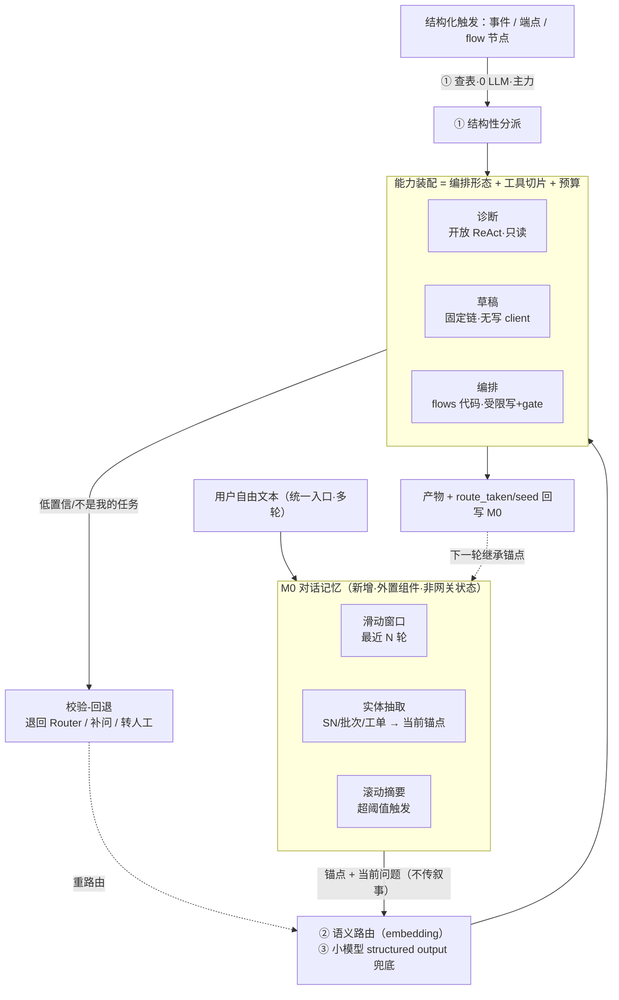

# Agent 路由与多轮上下文 —— 市面对照与演进方向

> **文档性质（一开口就讲清）**：本文**不是现状说明书，也不是已拍板的设计**，而是一次架构评审的对照记录——把 factorybot 现有的"结构性分派 + 规则关键词意图路由 + 前端透传 seed"放进 2025–2026 市面成熟 agent 的做法里对照，指出**哪些该保留、哪些偏脆、演进方向是什么**。所有标注"改 / 补 / 演进"的条目均为 **📐 演进方向（尚未落地、未拍板）**，落地前需按 §7 的选型决策逐项确认。
>
> **底座口径**：AgentScope 2.0（Python `>=3.12`）。**框架不提供 `Handoffs` / `Routing` / `Pipeline` / `MsgHub` 原语**（见 [Agent记忆系统-设计与实现方案.md](Agent记忆系统-设计与实现方案.md) 文首、[ADR-01/ADR-13](../架构设计v2/00-架构决策记录ADR.md)），本文所有"路由 / 移交"一律指应用层实现或待评估的第三方组件，不是框架能力。
>
> **第三方口径**：文中 `Mem0` / `Letta(MemGPT)` / `Zep(Graphiti)` / `semantic-router` / `vLLM Semantic Router` / `RouteLLM` / `OpenAI Agents SDK` / `LangGraph` 均为**市面第三方方案，非本仓库已引入依赖**，引用仅为对照，不代表选型承诺。
>
> **与既有文档的关系（避免重复）**：
>
> | 既有文档 | 讲了什么 | 本文补什么 |
> |---|---|---|
> | [Agent入口网关-意图路由.md](Agent入口网关-意图路由.md) | 现状：三种路由分工、规则优先 + LLM 兜底、无状态网关、传锚点不传历史 | 补：自由文本分类的**选型演进**、多轮**换方向 / 指代**的处理 |
> | [Agent记忆系统-设计与实现方案.md](Agent记忆系统-设计与实现方案.md) | 五层**执行侧记忆**（工作记忆续跑 / 上下文压缩 / 证据链 / 缓存 / 令牌） | 补：**对话侧记忆**（跨轮实体锚点、指代消解），是五层之外新的一层 |
> | [整体技术选型与模块划分.md](../整体技术选型与模块划分.md) §4 | 三层路由 + 能力装配全景图 | 补：路由层内部的市面对照与演进档位 |

---

## 1. 问题缘起

现有意图路由在**单轮**上工作良好，但用户**多轮对话中途切换方向**时暴露两处"偏硬"：

- **意图切换**：上轮"SN-001 过了哪几站"（检索）→ 这轮"那为什么焊接不良"（诊断）。
- **指代延续**：这轮的"它 / 这批 / 那"指向 SN-001，但 **seed 不在当前文本里**。

现有设计的两处应对被质疑"太硬编码"：

1. **自由文本用关键词规则**分类（`含"根因/5M1E"→DIAGNOSIS`）——脆、不泛化。
2. **前端手动透传 seed**——把指代消解的责任甩给调用方，纯对话入口无页面上下文时失效。

本文回答：市面成熟 agent 怎么处理这两件事，factorybot 该保留什么、改什么。

---

## 2. 先厘清：好的硬编码 vs 坏的硬编码

"硬编码"不是一个整体，要拆开看——**这一拆分是全文的地基**：

| 分派来源 | 是不是坏硬编码 | 市面怎么做 | 结论 |
|---|---|---|---|
| **事件类型**（`equipment.fault`→编排/`fault_response`） | 否，是**好硬编码** | 事件处理器 / 图边本就是代码，没人用 LLM 猜 | ✅ 保留 |
| **业务端点**（`POST /agent/diagnose`） | 否，是**好硬编码** | "点了'提交发票'就别让模型猜意图" | ✅ 保留 |
| **编排 flow 节点**（硬编码 `invoke("diagnosis")`） | 否，是**好硬编码** | 确定性流程节点用代码编排 | ✅ 保留 |
| **自由文本关键词匹配**（`含"根因"→诊断`） | **是，坏硬编码** | 换成 embedding 语义路由 / 小模型 structured output | ❌ 演进 |

> 核心判断（市面共识）：**Router 要不要用 LLM，看三件事——规则能不能写清楚、输入有没有语义歧义、错误路由代价多高。** 结构信号（事件/端点/按钮）规则写得清、无歧义 → 用代码；统一聊天框的自由文本有语义歧义 → 用学习型分类（embedding / 小模型），不用关键词。

---

## 3. 市面路由怎么做

### 3.1 四种编排路由模式

| 模式 | 控制方式 | 延迟 | LLM 成本 | 可调试性 | 适用 |
|---|---|---|---|---|---|
| **Router**（入口集中） | 1 次分类，确定路由 | 低 | 低 | 高 | 意图明确（**factorybot 属此类，选型没错**） |
| **Supervisor**（集中式） | 多轮决策 | 高 | 高 | 最高 | 复杂多步编排 |
| **Handoff**（分布式） | 每次交接 1 次 | 中 | 中 | 中 | 流程动态 |
| **Swarm**（去中心化） | Agent 自主并行 | 低 | 高 | 低 | 最灵活最难调 |

经验法则：**先用 Router**。有实测案例把单 agent 14 工具按 Router 拆分后，每 agent 工具数 ≤4、System Prompt 长度降约 60%、工具选择错误率 15%→3%，代价是端到端延迟约 +1.5s（多了 Router + Handoff 的 LLM 调用）——**与本项目 §5.4「工具规模治理」的收敛目标同源**。

### 3.2 意图分类三档（主流是分层混用，不是二选一）

| 档 | 机制 | 代表 | 成本/延迟 | 用在哪 |
|---|---|---|---|---|
| ① **硬结构信号** | 事件类型 / 端点 / 按钮 → 代码判定 | 所有框架的事件处理器、图边 | 0 LLM | 结构已知（本项目①结构性分派） |
| ② **语义路由（embedding）** | 查询向量 vs 路由原型 cosine 相似 | `semantic-router`、`vLLM Semantic Router`（2025.09，ModernBERT 分类器，官方称延迟/token 各降约 50%、准确率升约 10%）、`RouteLLM`（LMSYS, ICLR 2025，MT-Bench 省约 85% 成本） | 极低（<10ms） | 自由文本、成本敏感 |
| ③ **LLM 分类（structured output）** | 小模型 Enum 强约束输出 | OpenAI Agents SDK `triage_agent`、通用做法 | 一次 LLM 调用 | 高歧义、需最高准确率 |

> **关键**：②语义路由是 factorybot 现在缺的一档——它比关键词泛化、比 LLM 便宜，正好卡在中间。现有"规则优先 + LLM 兜底"的**分层结构是对的**，只是"规则"那一层用了最脆的关键词，应升级为 embedding 语义路由。

### 3.3 Router 错误可恢复闭环

市面强调"比永远判对更重要的是**错了能恢复**"：`选择 → 校验 → 回退`闭环——

- 目标能力识别"这不是我的任务"→ **退回 Router**（factorybot 现状只有 `UNKNOWN→转人工`，缺"能力退回"这一环）；
- 低置信度 → **补问用户** 或 交更强模型复核；
- 涉及付款 / 权限 / 删除等高风险 → **叠加代码规则 + 人工确认**（与本项目写令牌主闸 + HITL 一致，见 [ADR-04](../架构设计v2/00-架构决策记录ADR.md)）。

---

## 4. 市面多轮记忆怎么做

### 4.1 组合拳（很少只用一招）

真实生产配置（以电商客服为例）：**滑动窗口**（最近 N 轮原样）+ **常驻硬信息**（关键实体/约束放系统提示，不压缩）+ **滚动摘要**（超 token 阈值触发）+ **实体/事实抽取**（结构化）+ **向量检索**（按需召回旧细节）。

### 4.2 三流派对照

| 方案 | 机制 | 对 factorybot 的启发 |
|---|---|---|
| **Mem0** | 两阶段：Extraction 从最近对话 + 滚动摘要抽结构化事实；Update 用 LLM 判 ADD/UPDATE/DELETE（论文称 LOCOMO +26% 准确、token −90%） | **"它→SN-001" 由抽取自动解决**，不需前端手传 seed |
| **Letta / MemGPT** | OS 分页：Core Memory（常驻 ~2K）+ Recall + Archival，Agent 自主用 memory edit tools 管理 | 会话锚点可做成 Agent 自管 |
| **Zep / Graphiti** | bi-temporal 知识图谱（event time + transaction time），时序推理 | MES **版本锚点**时序场景可借鉴，但重，**不建议当主记忆层** |

### 4.3 与现有「Agent 记忆系统」的关系（重要：补的是新的一层）

现有 [Agent记忆系统](Agent记忆系统-设计与实现方案.md) 的五层是**执行侧记忆**——服务于"一次能力调用内部"的续跑、压缩、审计：

- M1 工作记忆 = gate 挂起-续跑（且**诊断能力明确不注册会话恢复**，§3.8）；
- M2/M3/缓存/L5 都是单会话执行内的事。

**缺的是"对话侧记忆"**——跨多个用户轮次、跨能力切换维护"当前在聊哪个实体、上一轮走了哪条路由"。本文提的会话记忆组件是**五层之外新增的一层（暂记 M0 对话记忆）**，不改动既有五层，也不与之冲突。

### 4.4 不触碰时变性红线（必须澄清）

现有文档因 MES 追溯时变性**默认关闭语义缓存**（答案随新数据漂移）。**对话记忆 ≠ 语义缓存**，二者不可混：

| | 记什么 | 是否违反时变性红线 |
|---|---|---|
| **语义缓存（禁用）** | "批次 B-77 焊接根因 = X" 这类**答案** | 违反——答案会漂移 |
| **对话记忆（可用）** | "用户当前在聊 SN-001、上一轮走了检索" 这类**锚点/意图** | 不违反——锚点不是答案 |

即：**记住"在聊什么实体"可以，缓存"根因答案"不行**。抽取出的实体锚点用于消解指代，不用于复用结论。

---

## 5. 映射回 factorybot：保留 / 改 / 补

| 现有做法 | 市面对照 | 判断 | 演进方向（📐 未拍板） |
|---|---|---|---|
| 结构性分派（事件/端点/flow 查表，0 LLM） | "点了提交发票别让模型猜" | ✅ **保留** | 不动 |
| 传锚点不传消息历史 | Handoff"传当前目标 + 已确认事实 + 订单号，不搬家全 history" | ✅ **保留** | 锚点从"仅 seed"扩到"seed + 当前目标 + last_route" |
| 规则优先 + LLM 兜底（分层） | 主流就是分层混合 | ✅ **结构对** | 不动结构 |
| 自由文本用**关键词**规则 | ② embedding 语义路由 / ③ 小模型 structured output | ❌ **改** | 关键词 → 语义路由，LLM 兜底保留 |
| 前端**手动**透传 seed | Mem0 式**自动抽取**实体到对话记忆 | ❌ **改** | 加 M0 对话记忆组件，自动消解指代 |
| `UNKNOWN → 转人工` | 选择-校验-**回退**闭环 | ⚠️ **补** | 加"能力退回 Router + 低置信补问" |

### 5.1 目标架构（演进后，📐 尚未落地）

> 要点：**M0 是外置组件（Mem0 式独立记忆服务），不是网关状态**——网关仍是薄分派器，读 M0 拿锚点、分派后把 `route_taken`/新 seed 回写 M0。这样既解决多轮指代，又不违背"无状态网关"原则（记忆外置为基础设施，与既有 M1~L5 同属"记忆分层"，只是补上对话侧）。

---

## 6. MES 的诚实边界（别过度设计，也别硬套市面）

有三点必须钉住，不能为了"像成熟 agent"而盲目照搬：

1. **框架约束**：AgentScope 2.0 **无原生 `Handoffs`/`Routing`**。OpenAI Agents SDK / LangGraph 那种"原生 triage + handoff"用不了。要么在应用层自研 routing（现状，所以"感觉手动/硬"），要么这块**局部评估引入第三方**——但引入 / 换框架是**大决定，需单独出 ADR 算账**，不在本文拍板。
2. **高风险写路径不能纯 LLM 自主**：市面自己也建议"付款/权限/删除等高风险操作叠加代码规则 + 人工确认"。本项目的过点红线 + 写令牌主闸 + HITL 正是此意，**不得为了 Swarm 式自主 handoff 放松写边界**。
3. **别上重记忆方案**：MES 真实流量多是**结构化事件 + MES 界面按钮**（提问式入口已在特定能力上下文中，seed 天然已知），**纯多轮自由对话占比小**。所以对话记忆**滑窗 + Mem0 式实体抽取够用，不要上 Zep bi-temporal 图那种重方案**——符合本项目"记忆按场景需要才上，不无脑全配"（记忆系统 §8.4）与"懂什么时候不用 AI"的一贯纪律。

---

## 7. 演进方向（分档，均未拍板）

渐进式，按成本/收益分档，可独立取舍：

| 档 | 动作 | 收益 | 代价 | 前提 / 是否触红线 |
|---|---|---|---|---|
| **档 0**（低成本，可先做） | 自由文本分类：关键词 → embedding 语义路由；前端 seed → 网关侧**薄会话锚点缓存**（`session_id → 最近 seed + last_route`，是 cache 非 state machine） | 去掉最脆的关键词；多轮指代基本可用 | 一个 embedding 模型 + 一份 Redis 锚点缓存 | 不触红线；仍在 AgentScope 内自研 |
| **档 1** | 引入 **Mem0 式实体抽取**作为 M0 对话记忆层；补 **Router 错误可恢复闭环**（能力退回 + 低置信补问） | 指代自动消解；误路由可恢复 | 记忆组件接线 + 抽取用 LLM 的成本 | 不触红线；抽取的是锚点非答案（§4.4） |
| **档 2**（大决定） | 评估这块**局部引入 LangGraph / OpenAI Agents SDK 的原生 routing/handoff**，或换编排框架 | 原生 triage/handoff、生态成熟 | 换/混框架的迁移与运维成本、与现有 `flows/` 应用层编排的整合 | **需单独 ADR**；与 [ADR-01/ADR-05/ADR-13](../架构设计v2/00-架构决策记录ADR.md) 一并权衡 |

> 建议顺序：**档 0 先落地验证**（投入最小、直接消解两处"偏硬"），据实测量再决定要不要走档 1；**档 2 非必要不启动**——除非对话入口成为主流量且自研 routing 维护成本明显超预期。

---

## 8. 选型决策待确认（开放问题）

落地前需先定这几项：

1. **指代消解归谁**：前端 BFF 透传 / 网关薄锚点缓存 / 独立 M0 记忆组件？（倾向：MES 界面入口走前端，纯对话入口走网关缓存或 M0，两者结合）
2. **语义路由的 embedding 模型**：本地小模型还是托管？是否复用 [LLM接入与模型兼容](LLM接入与模型兼容-设计与实现方案.md) 的 provider 抽象？
3. **对话记忆的作用域与 TTL**：`session_id` 维度还是 `user + 车间` 维度？锚点缓存 TTL 多长（对齐会话 30min？还是更短）？
4. **是否在 AgentScope 上自研 vs 引入第三方 vs 局部换框架**：即档 0/1/2 的取舍——**本文不拍板，需一次专门选型评审**。

---

## 9. 参考（市面方案，仅对照，非本仓库依赖）

| 名称 | 类别 | 一句话 |
|---|---|---|
| OpenAI Agents SDK / Swarm | 编排框架 | `triage_agent` + `handoffs` 原生移交 |
| LangGraph | 编排框架 | 状态图 + 条件边 + Supervisor/Router 节点 |
| `semantic-router` / vLLM Semantic Router | 语义路由 | embedding/ModernBERT 分类，<10ms 低成本路由 |
| RouteLLM（LMSYS, ICLR 2025） | 模型路由 | 预测强模型胜率，MT-Bench 省约 85% 成本 |
| Mem0 | 对话记忆 | 抽取+更新两阶段，token 效率优先 |
| Letta / MemGPT | 对话记忆 | OS 分页，Agent 自主管理 Core/Recall/Archival |
| Zep / Graphiti | 对话记忆 | bi-temporal 知识图谱，时序推理 |

---

> **一句话总结**：factorybot 的路由骨架（结构性分派、传锚点不传叙事、规则优先 + LLM 兜底的分层）**已与市面主流对齐**，真正偏脆的只有两处——**自由文本的关键词规则**（应升级为 embedding 语义路由 / 小模型分类）和**前端手动透传 seed**（应升级为 Mem0 式自动抽取的对话记忆 M0）。演进按档 0→1→2 渐进，**档 0 低成本可先做，档 2 换框架非必要不启动**；全程守住三条 MES 边界：写路径不纯 LLM 自主、记忆别上重方案、对话记忆只记锚点不记答案（不碰时变性红线）。
