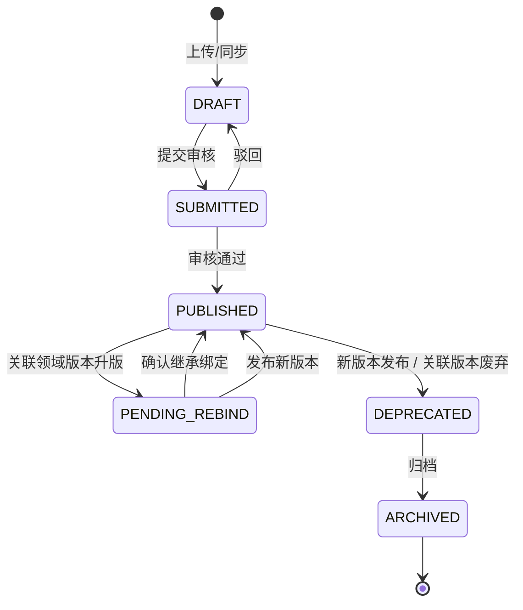

# rag-service 整体设计（文档知识服务 + Tool 接入 agent）

> **定位**：`rag-service` 是一个**只读的文档知识服务**。它把车间 SOP、作业指导书、检验标准、设备手册这类非结构化文档做成可检索、可引用、可回溯版本的向量知识库，并以 **AgentScope `Tool` over HTTP** 的形态接入 `agent-service`。
>
> **能力边界（先说清楚不再做什么）**：`rag-service` **不承载制造追溯**（关系型读模型、固定关联查询、MES 只读取证不在本服务，见 [制造追溯-需求与实现效果.md](../制造追溯-需求与实现效果.md)），**不做意图分诊**（归入口网关 `agent-gateway-service`，见 [Agent入口网关-意图路由.md](../AGENT服务/Agent入口网关-意图路由.md)），**不做多步检索编排**（编排权归 `agent-service`）。本服务只回答一件事：**给定问题与版本锚点，召回适用文档片段，返回带定位引用的证据**。
>
> **底座口径**：Python 3.12+ / FastAPI / **AgentScope 2.0**。文档解析与切块可复用 AgentScope **RAG 模块**的抽象，向量化走 **`Embedding`**，LLM 调用走 **`Model`**；ChromaDB 由本服务**自持 client** 接入。框架与版本的核实结论见 [架构设计v2/00-架构决策记录ADR.md](../架构设计v2/00-架构决策记录ADR.md) ADR-01 与 [基于AgentScope2.0的架构设计.md](../基于AgentScope2.0的架构设计.md) §3.2。框架只决定"怎么实现"，不改变本文的只读、版本与证据约束。
>
> **口径纪律**：本文是**设计阶段的引入规划**，不是线上已落地能力。讲法遵循 [项目亮点与指标卡片.md](../面试指南/项目亮点与指标卡片.md) §0——说"规划方向 / 设计取舍"，不说"我们已经上线文档 RAG"。

---

## 0. 职责边界与调用链

### 0.1 本服务提供与不提供的能力

| 项 | 是否由 rag-service 承担 | 说明 |
|---|---|---|
| 文档解析、切块、向量化、索引 | 是 | 摄入管线与 `document_chunks` collection |
| 文档版本治理、发布状态、重索引 | 是 | 文档子域自有状态机 + 领域事件驱动 |
| 按版本 / 租户 / 设备过滤的向量召回 | 是 | ChromaDB `where` pre-filter，过滤在召回前 |
| 带定位引用的文档证据输出 | 是 | `evidence_id` + `locator`（页码 / 偏移 / 标题路径） |
| 制造事实取证（过点、物料、设备、人员） | **否** | 归制造追溯能力，见 [制造追溯-需求与实现效果.md](../制造追溯-需求与实现效果.md) |
| 版本锚点解析（从工单 / 过点记录推当时版本） | **否** | 由追溯侧产出的三段锚点传入本服务 |
| 意图分诊、能力选择 | **否** | 归 `agent-gateway-service` |
| 多步检索编排、预算与停止条件 | **否** | 归 `agent-service` 的编排层 |
| 任何 MES 写操作 | **否** | 只读事件 + 只读 REST，永不回写 |

### 0.2 调用链

```text
前端 / 工位 UI / 责任人卡片
        │
        ▼
agent-gateway-service（唯一意图分诊：检索 / 诊断 / 草稿）
        │
        ▼
agent-service（唯一编排方：一个 ReAct 循环 + 确定性 flows）
   │  Toolkit
   ├── trace_lookup / record_expand / version_resolve   ← 制造追溯工具（归属待定，见追溯文档）
   └── search_docs ── httpx 只读 ──▶ rag-service（本文）
                                        │
                        ┌───────────────┼────────────────┐
                        ▼               ▼                ▼
                 ChromaDB（向量）   MySQL（文档治理）  Kafka（只读事件）
```

- **依赖单向**：`agent-service → rag-service`，`agent-service → 追溯工具`。rag-service **不反向依赖**追溯能力或 agent-service，避免成环。
- **编排唯一**：同一请求只允许一层 ReAct。`agent-service` 已在编排时，本服务以 `RETRIEVAL_ONLY` / 工具端点响应，绝不再启动自己的多步循环。
- **锚点单向**：三段 `VersionAnchor` 由追溯侧产出、由 `agent-service` 透传、由本服务消费与校验。本服务不做版本解析，也绝不"缺锚点就查最新 ACTIVE"。

### 0.3 已下线的形态与回滚口径

| 旧形态 | 现状 | 回滚条件 |
|---|---|---|
| `POST /rag/query` 的 `AUTO` 多步编排（本服务内 ReAct 追查） | **下线**，只保留 `RETRIEVAL_ONLY` 与工具端点 | 若出现"无 agent 运行时、仅需问答 UI 直连"的场景，可恢复为**单步**检索 + 生成，仍不得恢复多步循环 |
| `rag-doc-service` / `agentic-rag-service` 两套独立包结构 | **合并**为单一服务的模块划分 | 不计划回滚；扩缩容按进程角色拆分，不拆服务 |
| 制造追溯读模型、固定查询计划、MES 只读取证 | **迁出**本服务 | 见 [制造追溯-需求与实现效果.md](../制造追溯-需求与实现效果.md) 的归属决策与回滚条件 |

架构反转的背景、代价与回滚阈值记录在 [ADR-13](../架构设计v2/00-架构决策记录ADR.md)。

---

## 1. 设计目标与边界

### 1.1 目标

把车间**半结构化 / 非结构化知识**（SOP、作业指导书、IPC 标准、设备维修手册、检验标准、培训资料）做成可被 LLM 检索并给出**可点开来源**的知识库，让"SPI 报警怎么处置""首件检验流程是什么""贴片机 E027 怎么修"不再依赖工程师翻文档。

核心不是"把文档塞进向量库"，而是三件事同时成立：

1. **召回准**：按文档类型切块 + 向量召回 + 精排，答案能落到具体章节；
2. **版本对**：检索强制带版本锚点与发布状态过滤，从结构上杜绝答出失效 SOP；
3. **可回溯**：每条结论绑定 `evidence_id` + `locator`，人能点回原文。

### 1.2 硬边界

| 边界 | 说明 | 落地方式 |
|---|---|---|
| **只读 MES** | 文档库归 RAG 自有；对 MES 只读 | 订阅 `process.*` / `material.*` / `quality.*` 只读事件；降级查询走只读 REST；启动断言禁止写接口 |
| **不进过点主事务** | 摄入 / 重索引全异步 | 过点 P99 ≤200ms（[领域总览.md](../领域模型/领域总览.md) §4.1）不受影响；文档检索容忍秒级延迟 |
| **版本一致性** | 工艺绑定型文档检索必须带版本锚点（三段） | chunk metadata 固化版本字段；检索 `where` 前置过滤；缺锚点拒答 |
| **权限隔离** | 不同车间 / 产线可见文档不同 | `tenant_scope` 在向量近邻**之前**裁剪，不是答完再删 |
| **证据约束** | 无引用的答案判失败 | `DocAnswer` 强制 `citations`；生成后 `CitationPolicy` 校验 |
| **查询有界** | 向量召回与重排有上限 | `top_k` / `top_n` / 超时 / 返回条数全部配置化 |
| **部署适配** | 车间网可能隔离 | ChromaDB + bge-m3 + bge-reranker 本地化；LLM provider 可替换 |

### 1.3 设计取舍

1. **文档检索退化为工具，而不是入口**：入口与编排都上移，本服务只保证"一次检索做对"，简单请求不为多步付成本。
2. **版本治理优先于模型能力**：MES 对错误答案零容忍，一条失效 SOP 会直接导致批量不良。向量是主体，版本治理才是灵魂。
3. **chunk 不可变**：文档升版追加新 chunk，不翻转旧 chunk，用版本字段隔离——这也是 ChromaDB 多记录无事务弱点的规避手段。
4. **证据先于生成**：先产出结构化文档证据，再让模型基于证据组织答案；证据不足时返回缺口或低置信度，不硬答。
5. **框架可替换**：向量库、Embedding、Rerank、LLM 都封在适配层后，框架 RAG 抽象缺位时降级为自持 client，对外契约不变。

---

## 2. 对外 Tool 契约

### 2.1 工具清单（本服务只提供两个）

| Tool | 端点 | 用途 | 必填约束 |
|---|---|---|---|
| `search_docs` | `POST /rag/docs/search` | 按问题 + 版本锚点召回文档片段证据 | `version_anchor` 或 `evidence_set_id` 二选一必填（工艺绑定型） |
| `fetch_doc_answer` | `GET /rag/answers/{answer_id}` | 回查某次文档答案与其引用的文档侧证据 | `answer_id` |

> 跨能力的**统一证据集回查**（文档 + 制造记录）由 `agent-service` 的 EvidenceRegistry 承担（`GET /agent/evidence-sets/{id}`），本服务只回查"文档侧答案与引用"，避免两处都能签发证据集导致口径分裂。

### 2.2 `search_docs` 入参 / 出参

```python
class VersionAnchor(BaseModel):
    version_kind: Literal["route", "bom", "rule", "asset", "standard"]
    version: str
    version_ref_id: str          # 该版本的权威记录 ID，三段缺一不可

class SearchDocsRequest(BaseModel):
    context_id: str              # 服务端签发，映射租户/预算/证据集；模型不得自造
    query: str
    version_anchor: VersionAnchor | None = None   # 与 evidence_set_id 二选一
    evidence_set_id: str | None = None            # 由 agent 侧传入，服务端取已固化锚点
    doc_types: list[str] | None = None            # SOP / MANUAL / STANDARD ...
    doc_category: Literal["PROCESS_BOUND", "ASSET_BOUND", "GENERAL"]
    asset_id: str | None = None                   # 设备绑定型过滤
    top_k: int = 20
    rerank_top_n: int = 5

class DocEvidence(BaseModel):
    evidence_id: str
    document_id: str
    version_id: str
    version_no: str
    title: str
    section_type: str | None     # STEP / FAULT_CODE / PARAM / NOTE
    locator: dict                # {page, offset, heading_path}
    quoted_text: str
    score: float
    version_anchor: VersionAnchor | None

class SearchDocsResponse(BaseModel):
    evidences: list[DocEvidence]
    anchor_used: VersionAnchor | None
    missing_evidence: list[dict] # 锚点缺失 / 无命中 / 命中但被状态过滤
    degraded: bool
    trace_id: str
```

契约要点：

- **锚点或证据集二选一必填**：给了 `evidence_set_id` 时由服务端从证据集读取已固化锚点，避免模型手抄版本号出错。
- **残缺锚点直接拒绝**：`version_kind` / `version` / `version_ref_id` 三段不全视为无效请求，返回 `VERSION_ANCHOR_INVALID`，不退回"查当前生效版"。
- **不得传租户**：租户只来自 `context_id` 的服务端解析；请求体里出现 `tenant_id` 一律忽略并告警。
- **不得传 SQL / 集合名 / 顶层过滤表达式**：过滤维度只允许契约列出的字段。

### 2.3 错误码

| 错误码 | 含义 | 调用方处置 |
|---|---|---|
| `VERSION_ANCHOR_INVALID` | 锚点残缺或与 `doc_category` 不匹配 | 回溯追溯工具重新解析锚点 |
| `VERSION_ANCHOR_MISMATCH` | `evidence_set_id` 内锚点与显式锚点冲突 | 停止，展示冲突，不自动切换 |
| `TENANT_FORBIDDEN` | `context_id` 与请求范围不符 | 拒绝并审计 |
| `NO_MATCH` | 过滤后无候选 | 返回缺口，允许换查询词重试一次 |
| `INDEX_UNAVAILABLE` | ChromaDB 不可用 | 降级为"文档建议缺失" |
| `BUDGET_EXCEEDED` | 调用方传入的预算已耗尽 | 直接失败，不静默降级 |

---

## 3. 文档领域建模

### 3.1 按是否绑定领域版本分类

| 类别 | 文档类型 | 是否绑定领域版本 | 版本治理策略 |
|---|---|---|---|
| **工艺绑定型** | SOP、作业指导书、检验标准 | 是，绑定三段锚点 | 随工艺版本生命周期重索引；检索必须带版本过滤 |
| **设备绑定型** | 设备维修手册、设备操作手册 | 绑定 `asset_id` / 设备型号 | 按文档自身版本管理，不随工艺版本变 |
| **通用知识型** | IPC 标准、培训资料、8D 报告 | 否 | 按文档自身版本 + 生效状态管理 |

> **8D 是否纳入首版**：8D 是"曾经怎么处理"的案例检索，与 SOP 的规范检索性质不同，切分与提示词策略也不一样。首版不纳入，列为扩展项，需独立评测后再定。

### 3.2 聚合根 / 实体 / 值对象

```text
KnowledgeDocument（聚合根）
  ├─ document_id, doc_type(SOP/MANUAL/STANDARD), title, category, tenant_scope
  └─ DocumentVersion（实体）
       ├─ version_id, version_no, state, source, file_ref, file_content_hash
       ├─ effective_at / deprecated_at
       ├─ bindings: list[DocumentBinding]（值对象）
       │     ├─ binding_type   route / bom / rule / asset / standard
       │     ├─ target_ref     version_kind + version + version_ref_id
       │     └─ inherited      是否继承自上一版本
       └─ DocumentChunk（实体）
            ├─ chunk_id, ordinal, text, embedding
            ├─ section_type   步骤 / 故障代码 / 参数 / 注意事项
            └─ locator        页码 / 段落偏移 / 标题路径
```

- **`KnowledgeDocument` 是聚合根**：管元信息与版本集合的一致性；同一文档同类绑定在任一时刻只有一个 `PUBLISHED`。
- **`DocumentVersion` 是聚合内实体**：发布后内容不可改，改内容只能发新版本。
- **`DocumentChunk` 是版本内实体**：向量挂在 chunk 上，chunk 写入后**不可变**。
- **`DocumentBinding` 是值对象**：描述"这个文档版本对齐哪个领域版本"，`inherited` 区分主动绑定与继承绑定。

### 3.3 领域服务

| 服务 | 职责 |
|---|---|
| `DocumentIngestionService` | 解析 → 切块 → 向量化 → 持久化 → 发布事件，单一职责 |
| `ReindexCoordinator` | 消费领域事件，驱动版本状态流转与重新绑定（跨多文档逻辑放服务，不放实体） |
| `DocumentRetrievalService` | 锚点校验 → 向量召回 → 精排 → 组织证据 / 答案 |

---

## 4. 版本治理与重索引

### 4.1 文档版本生命周期



- `PUBLISHED` 才进入默认检索；`DEPRECATED` 不再召回，但**已发布的引用仍可点开回溯**。
- **新版本 PUBLISHED 时旧版本自动 DEPRECATED**，保留不删。

### 4.2 文档与领域版本的绑定（核心决策）

| 方案 | 绑定粒度 | 领域版本升级时的行为 | 结论 |
|---|---|---|---|
| A. 1:1 绑定具体版本记录 | 文档版本绑定 `route_version` | 必须为新版本发新文档版本 | 强一致但文档膨胀 |
| **B. 独立版本化 + 绑定关系（采用）** | `DocumentBinding` 多对多关联版本 | 内容不变则 `inherited=true` 继承；内容变则发新版本 | 兼顾灵活与可回溯 |
| C. 只绑工艺路线 ID | 绑定 `route_id` | 文档不动，检索取当前版本 | **否决**：无法回溯历史，违反版本一致性 |

- 采用方案 B：不因工艺微调就重发 SOP，同时保留"查历史单件按当时版本取 SOP"的能力。
- **"内容是否需要变"不由机器假设**：领域版本升级后，关联文档进入 `PENDING_REBIND`，由文档 owner 确认继承绑定或发新版本。宁可让人确认，不可自动假设 SOP 不变。
- 设备绑定型 / 通用知识型不绑工艺锚点，不受工艺变更事件影响。

### 4.3 重索引事件订阅

| 领域事件 | 订阅目的 | 动作 |
|---|---|---|
| `ProcessRouteActivated` | 工艺升版 | 旧锚点关联文档 → `PENDING_REBIND`；通知文档 owner |
| `ProcessRouteDeprecated` | 工艺废弃 | 关联文档版本 → `DEPRECATED`（不删） |
| `BomActivated` | BOM 升版 | BOM 相关文档重绑定 |
| `QualityGateRuleActivated` | 质量规则升版 | 检验标准文档重绑定 |
| `rag.reindex.request` | 外部证据侧（制造追溯）请求 | 按三段锚点重索引关联文档 |
| `DocumentVersionPublished` | 内部发布 | 同文档同类绑定旧版本 → `DEPRECATED` |

### 4.4 三道闸

| 闸 | 位置 | 作用 |
|---|---|---|
| 摄入闸 | 文档版本状态机 + 绑定校验 | 未 `PUBLISHED` 不进入可检索集合 |
| 重索引闸 | `ReindexCoordinator` | 领域版本变化驱动状态流转与重新绑定 |
| 检索闸 | ChromaDB `where` pre-filter | `state='PUBLISHED'` + 版本 + 租户前置过滤 |

> **版本一致性不是 RAG 自己保证的，是从领域模型兜上来的**：领域版本有生命周期、变更发事件、文档绑定对齐锚点。RAG 只严格遵循这套契约，不另搞一套版本管理。

### 4.5 与制造追溯的版本协同

- 追溯侧从目标过点 / 工单记录解析出**当时的三段锚点**，作为 `version_anchor` 或随证据集传入本服务。
- 本服务只用同一锚点做 `where` 过滤，**不独立解析、不推断、不回退当前版本**。
- 两侧锚点冲突（例如证据集内是 `v3`、显式入参是 `v4`）时返回 `VERSION_ANCHOR_MISMATCH`，交由编排层停止并暴露冲突，不做自动纠正。

---

## 5. 摄入与切分

### 5.1 摄入管线

```text
原始文档(PDF/Word/HTML/MD)
  → 内容 hash 计算与查重（幂等）
  → 解析（保留标题层级、表格、步骤编号）
  → 按 doc_type 选切分策略
  → bge-m3 批量向量化（1024 维）
  → MySQL 写入文档/版本（事务）+ ChromaDB 批量 upsert（chunk + 向量 + metadata）
  → 发布 DocumentVersionPublished
```

- 以 `(doc_id, version_no, chunk_seq, chunk_strategy_version)` 作为幂等键；同一文件重复摄入不产生重复 chunk。
- 原始文件与解析结果按版本保存，重跑切分不会覆盖其他版本。

### 5.2 切分策略

| 文档类型 | 切分策略 | 理由 |
|---|---|---|
| SOP / 作业指导书 | 按工序步骤切，步骤内按段落 | 检索"某站怎么操作"能命中完整步骤 |
| 设备维修手册 | 按故障代码 / 章节标题切 | 检索"E027 怎么修"能命中完整章节 |
| 检验标准 | 按检验项切，参数表整体保留 | 检索"某项标准值"能命中参数表 |
| IPC 标准 | 章节切 + 长度兜底 | 结构规整，兼顾语义与长度 |
| 培训资料 | 语义切分 | 弱结构，按语义边界切 |

- 起始参数：256–512 token，重叠约 10%；具体值需按真实文档评测调优后锁定。
- 切分时标注 `section_type`，支持"只查故障代码章节"这类过滤。

### 5.3 ChromaDB collection 与 metadata

| 字段 | 说明 |
|---|---|
| `id` | `{doc_id}:{version_id}:{chunk_seq}` |
| `embedding` | bge-m3，1024 维，cosine |
| `text` | 分块文本 |
| `doc_id` / `version_id` / `doc_type` | 来源与类型 |
| `version_kind` / `version` / `version_ref_id` | 三段锚点，检索主维度 |
| `state` | 写入时固定 `PUBLISHED`（chunk 不可变） |
| `tenant_scope` | 租户 / 车间 / 产线范围 |
| `chunk_seq` / `section_type` / `locator` | 幂等、章节类型、定位 |
| `file_content_hash` | 源文件 hash，摄入幂等 |
| `effective_from` / `effective_to` | 时间语义（当前指导 vs 历史查询） |

- **chunk 不可变**：写入后 metadata 不再修改。升版追加新 chunk，版本隔离靠 `version_kind` + `version` 过滤。
- **`document_version.state` 与 `chunk.state` 解耦**：版本层状态照常流转；chunk 层固定 `PUBLISHED`，靠版本号隔离。
- 单条软删（文档撤回）允许 upsert 改 `state`，批量翻转不允许。

---

## 6. 检索与生成

### 6.1 检索链路

```text
问题 + 锚点/设备上下文
  → 锚点校验（三段完整性 / 与 doc_category 匹配）
  → bge-m3 向量化
  → ChromaDB where pre-filter 召回 top_k
  → bge-reranker 精排到 top_n
  → 组织 DocEvidence（含 locator）
```

### 6.2 前置过滤

```text
where = {"state": "PUBLISHED"}
if 工艺绑定型: where["version_kind"="route"]; where["version"]=anchor.version
if 设备绑定型: where["version_kind"="asset"]; where["version_ref_id"]=asset_id
if 租户范围:   where["tenant_scope"]={"$in": scopes}
if 文档类型:   where["doc_type"]={"$in": doc_types}
```

- 过滤在**近邻之前**完成：不达标的数据根本不进候选，避免"先召回再裁剪"导致越权片段进入模型上下文。
- `DEPRECATED` / `PENDING_REBIND` / `ARCHIVED` 天然不进候选。

### 6.3 生成与引用

- `RETRIEVAL_ONLY` 模式只返回证据，不调 LLM——这是 agent 侧做多步编排时的默认模式。
- 生成模式（供无编排的工位 UI 直连，单步）输出 `DocAnswer`：`citations` 强制引用 `evidence_id` + `locator`，无引用的答案判失败重试。
- 系统提示词约束：只能基于提供的文档片段回答，片段不相关时明确回答"未找到相关文档"，禁止编造。
- `confidence < 0.6` 或无引用 → `needs_human_review=True`，不展示给操作工，只推工程师。

---

## 7. 与 14 个限界上下文的关系

本服务**不投影**任何聚合根（投影与读模型归制造追溯能力），只通过文档绑定关系对齐领域版本：

| 文档类别 | 绑定的领域对象 | 对齐上下文 | 驱动重索引的事件 |
|---|---|---|---|
| 工艺绑定型 | `version_kind=route` + `version_ref_id=route_id` | 工艺管理 | `ProcessRouteActivated` / `ProcessRouteDeprecated` |
| 检验标准 | MVP 先按 `route` 归属，后续可切 `rule` | 质量 | `QualityGateRuleActivated` |
| 物料相关 | `bom_id` + `bom_version` | 物料 | `BomActivated` |
| 设备绑定型 | `asset_id` / 设备型号 | 设备工装台账 | `AssetCommissioned`（型号变更时） |
| 通用知识型 | 无领域版本绑定 | — | 无 |

- 本服务是 MES 领域的**只读消费者**：只订阅事件做重索引与重新绑定，不回写任何上下文。
- 事件 envelope 与消费侧幂等沿用既有模式（[Outbox设计方案.md](../实现说明/业务事件/Outbox设计方案.md) §3.1 / §7.6 / §8.2 / §8.3），不造新契约。

---

## 8. 技术底座

### 8.1 组件职责

| 组件 | 职责 |
|---|---|
| 文档解析 | unstructured + pypdf + python-docx，保留标题层级与表格 |
| 切块 | 按 doc_type 选择 NodeParser（可复用 AgentScope RAG 模块的解析/切块抽象） |
| 向量化 | bge-m3，经 AgentScope `Embedding` 抽象接入，1024 维 cosine |
| 向量存储 | **ChromaDB 自持 client**（`chromadb>=0.5`），嵌入式 persistent client，collection `document_chunks` |
| 精排 | bge-reranker-v2-m3，cross-encoder |
| LLM | AgentScope `Model` + 显式 `Credential`，provider 可插拔 |
| 文档治理 | MySQL（文档、版本、绑定、幂等、位点、审计） |
| 事件 | aiokafka 消费者组，只读订阅 |
| 可观测 | AgentScope `TracingMiddleware`（OTel 入口）+ prometheus-client + 结构化日志 |
| Web | FastAPI lifespan、统一异常、DI、健康检查 |

### 8.2 框架接入风险注

AgentScope 的 `rag/` 模块真实存在，但**已核实的适配器只有 Qdrant / MilvusLite / Elasticsearch / MongoDB，没有 ChromaDB 适配器**；且该模块在 **2.0.0 曾被整体删除、2.0.5 起才回归**（证据见 [ADR-01](../架构设计v2/00-架构决策记录ADR.md) 的 RAG 模块行）。

因此落地口径固定为：

1. `agentscope` **pin 到具体小版本**，CI 增加 API 漂移检查；
2. ChromaDB 一律经**本服务自持 client** 接入，封装在检索适配层之后；
3. 框架 RAG 抽象只用在解析 / 切块 / 召回这类与向量库无关的环节；
4. 降级预案：该模块再次缺位或升级中断时，切自持 client 直连，`search_docs` 的只读契约、元数据过滤与引用口径**不变**。

> LlamaIndex 仅作为**可替换实现细节**（NodeParser / ChromaVectorStore 封装）存在于适配层内，不再是"检索编排层"。若团队决定全面去 LlamaIndex，适配层签名不变。

### 8.3 部署形态

- 作为 `rag-service` 单服务部署；API 与 Kafka 消费者可按进程角色拆分，共用代码与领域模型。
- ChromaDB、MySQL、Redis、Kafka 分别配置连接池、超时与就绪检查。
- 车间网隔离时：向量库、Embedding、Reranker 本地化；LLM 视安全策略走云端 API 或本地模型，`Model` 抽象保证切换零代码改动。
- 原始文档文件不入向量库，ChromaDB 只存文本 chunk + 向量 + metadata。

---

## 9. 对外接口

### 9.1 端点清单

| 方法 | 路径 | 用途 | 调用方 | 认证 |
|---|---|---|---|---|
| POST | `/rag/docs/search` | 文档片段检索，返回证据（`search_docs` Tool） | agent-service | 服务间 mTLS / Token + `context_id` |
| POST | `/rag/docs/query` | 单步检索 + 生成（**仅** RETRIEVAL_ONLY 之外的直连场景） | 工位 UI（可选） | 用户 Token |
| GET | `/rag/answers/{answer_id}` | 回查文档答案与文档侧引用 | agent-service / 审计 | 服务间 Token |
| GET | `/rag/answers/{answer_id}/evidence` | 回查该答案的文档证据集 | agent-service / 审计 | 服务间 Token |
| POST | `/rag/documents` | 上传 / 同步文档（创建 DRAFT 版本） | 文档管理员 | 管理 Token + RBAC |
| POST | `/rag/documents/{id}/versions/{v}/publish` | 发布版本（触发切块与索引） | 文档管理员 | 管理 Token + 双人复核（可选） |
| POST | `/rag/documents/{id}/versions/{v}/rebind` | 确认继承绑定 / 切新锚点 | 文档 owner | 管理 Token |
| GET | `/rag/documents/{id}/status` | 版本状态、索引状态、缺口 | 文档管理员 / agent | 服务间或用户 Token |
| GET | `/rag/explain/{audit_id}` | 解释一次检索（召回、过滤、重排、拒答原因） | 工程师 / 评测 | 内部 Token |
| GET | `/health` `/ready` `/metrics` | 探针与指标 | K8s / Prometheus | 内网 |

### 9.2 接口纪律

- **不提供** `POST /rag/query` 的 `AUTO` 多步编排；同一路径若保留 `mode` 参数，只接受 `RETRIEVAL_ONLY`，其余取值返回 `MODE_NOT_SUPPORTED`。
- 写类端点（文档上传 / 发布 / 重绑定）只改本服务自有数据，永不触达 MES。
- 检索端点必须带 `context_id`；`context_id` 与请求体中的租户字段冲突时以 `context_id` 为准并告警。
- 所有检索请求落审计：`trace_id`、`context_id`、锚点、过滤条件摘要、命中 chunk id、耗时。

---

## 10. 存储、一致性与重建

### 10.1 存储分工

| 存储 | 内容 | 一致性要求 |
|---|---|---|
| MySQL | `knowledge_document`、`document_version`、`document_binding`、`index_idempotency`、`index_offset`、`rag_audit` | 强一致；版本状态机事务化 |
| ChromaDB | `document_chunks`（文本 + 向量 + metadata） | 最终一致；幂等 upsert |
| 对象存储 / 文件系统 | 原始文档、解析中间产物 | 按版本留存，不覆盖 |

### 10.2 发布事务与索引一致性

以 MySQL 为**权威源**，ChromaDB 为**可重建派生物**：

1. 版本置 `PUBLISHED`、写入 `index_idempotency` 记录（事务提交）；
2. 异步批量 upsert chunk；
3. 全部成功后再置 `index_state=READY`，对外可检索。

- 中途失败：`index_state=FAILED`，版本不可检索；由重试或重建任务补齐。
- 检索命中但 MySQL 中该版本非 `PUBLISHED` → 兜底丢弃并打 `rag_doc_deprecated_leak_total`（期望恒为 0）。

### 10.3 重建

- 全量重建：按 MySQL 版本记录重跑切分 + 向量化，写入新 collection 别名后原子切换。
- 重建期间对外仍读旧 collection，切换后旧 collection 保留一个周期再删。
- 重建是**只读**行为：不触发任何领域事件，不改 MES 侧数据。

---

## 11. 只读、安全与启动断言

| Gate | 检查项 | 失败行为 |
|---|---|---|
| `ReadOnlyGate` | 出站 HTTP 只允许 GET / 白名单只读端点 | 启动失败 |
| `IndexGate` | collection 存在、维度 1024、距离 cosine | 启动失败 |
| `AnchorGate` | 检索路径必过锚点校验器，无旁路分支 | 单测覆盖 + 启动自检 |
| `TenantGate` | 所有检索入口必须解析出 `tenant_scope` | 启动失败 |
| `RawDocGate` | 原始文档目录只读挂载 | 启动失败 |
| `ModelGate` | LLM / Embedding provider 可用性与配额 | 启动降级并告警 |

运行时约束：

- 请求体出现 `tenant_id` / `sql` / `collection` / `where_raw` 等字段一律拒绝（**不静默忽略**，因为静默忽略会掩盖越权尝试）。
- 文档管理端点按 RBAC 校验；发布与重绑定操作记审计（操作人、前后状态、锚点差异）。
- 不引入任何写 MES 的代码路径；若未来需要回写文档状态给 MES，走 MES 应用服务，不在本服务直连。

---

## 12. 可观测与审计

### 12.1 指标

| 指标 | 类型 | 用途 |
|---|---|---|
| `rag_search_latency_seconds` | histogram | 检索 P95/P99（不含生成） |
| `rag_search_total{mode,degraded}` | counter | 调用量与降级率 |
| `rag_recall_candidates` | histogram | 召回候选数（过滤前后） |
| `rag_anchor_reject_total{reason}` | counter | 锚点拒绝次数与原因 |
| `rag_doc_deprecated_leak_total` | counter | 失效版本泄漏，**期望 0** |
| `rag_ingest_lag_seconds` | gauge | 摄入 / 重索引延迟 |
| `rag_reindex_pending_versions` | gauge | `PENDING_REBIND` 积压 |
| `rag_citation_missing_total` | counter | 无引用答案数 |

### 12.2 链路

- `TracingMiddleware` 在入口生成 / 续接 `traceparent`，工具调用出站透传；`agent-service` 的 trace 与本服务 span 属于同一条链路。
- 审计记录与 trace 通过 `trace_id` 关联；`/rag/explain/{audit_id}` 可还原一次检索的完整判定过程。

### 12.3 告警

- `rag_doc_deprecated_leak_total > 0`：立即告警，按 P1 处理（等同于答出失效 SOP）。
- `PENDING_REBIND` 积压超过阈值：提醒文档 owner，避免工艺升版后文档长期处于待确认。
- `INDEX_UNAVAILABLE` 持续：降级并告警，不让 agent 侧误以为"没有文档"。

---

## 13. 降级与故障矩阵

| 故障 | 对外语义 | 降级动作 | 不允许的行为 |
|---|---|---|---|
| ChromaDB 不可用 | 文档证据缺失 | `degraded=true` + `missing_evidence` 说明 | 静默返回空列表冒充"无相关文档" |
| Embedding 服务不可用 | 无法检索 | 直接返回 `INDEX_UNAVAILABLE` | 用关键词兜底冒充语义检索结果 |
| LLM 不可用 | 只返回证据 | 强制 `RETRIEVAL_ONLY` | 返回模板化假答案 |
| Reranker 不可用 | 精度下降 | 用向量分数排序，标记 `degraded` | 改变 `top_n` 语义 |
| MySQL 不可用 | 无法校验版本状态 | 拒绝检索（fail closed） | 跳过状态校验继续召回 |
| Kafka 消费滞后 | 版本状态可能过期 | 检索仍以 MySQL 状态为准 | 以事件缓存状态替代权威状态 |
| 锚点缺失 | 拒答 | 返回 `VERSION_ANCHOR_INVALID` + 缺口说明 | 回退查"当前生效版" |

---

## 14. 评测（文档侧）

本服务只对自己的检索质量负责；跨能力的端到端评分归 [RAG与Agent评测](../RAG与Agent评测/RAG与Agent评测-设计与实现方案.md)，追溯工具与编排层的评分归追溯文档与 agent 侧。

| 指标 | 定义 | 首版目标 |
|---|---|---|
| Recall@5 | 金标准答案所在 chunk 进入前 5 的比例 | ≥ 0.80 |
| MRR | 首个正确 chunk 的倒数排名均值 | ≥ 0.65 |
| 引用可定位率 | `locator` 能定位到原文的比例 | ≥ 0.95 |
| 版本过滤正确率 | 锚点场景下不返回其他版本的比例 | **1.00**（硬断言） |
| 跨租户泄漏率 | 返回他租户片段的比例 | **0.00**（硬断言） |
| 无引用答案率 | 无 `evidence_id` 的答案占比 | 0（拒答不算） |
| 检索 P95 | 不含生成的端到端检索耗时 | ≤ 1.0s |

- 版本过滤与跨租户泄漏是 **hard gate**：CI 中失败即阻断发布，不参与加权。
- 金标准集与追溯、编排共用同一批历史案例，但**分母各自计算**，避免把文档召回问题算到追溯头上。

---

## 15. 分阶段交付

| 阶段 | 范围 | 出口条件 |
|---|---|---|
| P0 摄入与检索 | 解析、切分、ChromaDB、`search_docs`（无锚点、通用知识型） | Recall@5 ≥ 0.75，接口契约测试通过 |
| P1 版本治理 | 版本状态机、绑定方案 B、事件驱动重索引、锚点强校验 | 版本过滤正确率 = 1.00，`deprecated_leak = 0` |
| P2 工具接入 | AgentScope Tool 描述、`context_id` 校验、超时与预算透传、与 agent 契约测试 | agent 侧可单跳取证，锚点缺失拒绝用例通过 |
| P3 质量与评测 | Reranker、评测集、指标埋点、灰度和降级演练 | 全量指标达标，降级矩阵演练通过 |
| P4 知识扩展 | 设备手册按型号、8D 案例（独立评测后） | 各自独立评测通过再纳入 |

> **与追溯、编排的排期关系**：本服务的 P0-P2 可独立先行；追溯与编排的交付节奏见 [制造追溯-需求与实现效果.md](../制造追溯-需求与实现效果.md)，两者通过契约解耦，不互相阻塞。

---

## 16. 关键决策与口径红线

### 16.1 关键决策

| # | 决策 | 理由 |
|---|---|---|
| 1 | 文档检索只做**工具**，不做问答入口 | 编排权归 agent，避免双 ReAct 套娃与预算双算 |
| 2 | 制造追溯迁出本服务 | 追溯是结构化取证，与"文档召回 + 引用"是两种负载；混在一体导致部署与扩缩容互相牵制 |
| 3 | ChromaDB 自持 client | 框架无 Chroma 适配器且 `rag/` 有过被删历史，必须把风险挡在适配层外 |
| 4 | chunk 不可变 + 版本字段隔离 | 规避 ChromaDB 批量更新无事务的弱点 |
| 5 | 绑定方案 B + `PENDING_REBIND` | 兼顾"不因微调重发 SOP"与"历史可回溯"，且不替人假设内容是否失效 |
| 6 | 锚点三段、单向流动、缺则拒答 | 版本锚定是模型外的确定性层，不靠相似度，也不靠模型自觉 |
| 7 | 过滤前置而非后置 | 越权 / 失效片段根本不进模型上下文，杜绝"先污染再删" |
| 8 | 只回查文档侧引用，统一证据集归 agent | 一处签发证据集，避免两套 `evidence_set_id` 并存 |

### 16.2 口径红线

| 禁止表述 | 推荐表述 |
|---|---|
| "RAG 统一承接文档检索与制造追溯" | "RAG 只提供文档知识工具；制造追溯是独立能力，见追溯文档" |
| "RAG 自己做多步 Agentic 检索" | "多步编排归 agent-service；RAG 只做单步检索与证据输出" |
| "ChromaDB 经 AgentScope RAG 模块接入" | "ChromaDB 自持 client 接入，框架 RAG 抽象只用于解析 / 切块" |
| "取不到版本就查最新生效版" | "取不到锚点即拒答，回退当前版本判为缺陷" |
| "先召回再按权限过滤" | "权限与版本在向量近邻之前前置过滤" |
| "用 LlamaIndex 做检索编排" | "LlamaIndex 只作为适配层内的可替换实现细节" |

---

## 17. 面试 Q&A（架构层）

**Q1：为什么把 RAG 从"问答入口"降级为"工具"？**
A：编排权只能有一个。RAG 既做召回又做多步追查，agent 侧也在做多步编排，就会形成两层 ReAct：延迟与 token 叠加、trace 嵌套、预算各算一套。降级为工具后，RAG 保证"一次检索做对"，多步决策归 agent，单跳优先原则才真正成立。

**Q2：制造追溯为什么不在 RAG 里？**
A：追溯是结构化取证（读模型 + 固定查询计划 + 版本解析），RAG 是语义召回 + 引用生成。两者的数据源、扩缩容特征、故障模式都不同：向量库挂掉不应导致追溯不可用，追溯同步积压也不该拖慢文档检索。拆开后各自独立演进，契约不变。

**Q3：为什么版本锚点必须三段且单向流动？**
A：`version` 字符串可能被复用或跨路线重名，必须带 `version_ref_id` 才能唯一指向权威记录；`version_kind` 区分工艺 / BOM / 规则 / 设备，避免把 BOM 版本当工艺版本用。单向流动是因为解析锚点需要读制造记录，那只在追溯侧；RAG 只消费，才不会出现两套解析逻辑给出两个版本。

**Q4：ChromaDB 有什么坑，怎么规避？**
A：批量 upsert 没有事务，元数据更新可能部分成功；`where` 过滤是字符串精确匹配，不适合模糊条件；嵌入式模式受单机资源限制。规避手段是 chunk 不可变 + 版本号隔离 + MySQL 作权威源 + 可重建 collection 别名切换，并自持 client 绕开框架适配器缺失。

**Q5：文档升版后旧 chunk 怎么处理？**
A：不翻转、不删除。chunk 写入即固定 `state=PUBLISHED`，靠 `version_kind` + `version` 过滤隔离；`document_version` 层照常 `DEPRECATED`。这样历史工单回溯时，按当时锚点仍能取到当时的 SOP。

**Q6：怎么保证不答出失效 SOP？**
A：四层：① 状态过滤前置（非 `PUBLISHED` 不进候选）；② 锚点强制（缺锚点拒答，不回退当前版本）；③ 兜底检查（命中后回查 MySQL 状态，不一致即丢弃并打 `deprecated_leak`）；④ 事件驱动重索引（工艺升版把关联文档推入 `PENDING_REBIND`，人工确认后才回到可检索）。

**Q7：为什么绑定方案选 B，而不是 1:1 绑定？**
A：1:1 绑定下，工艺每次微调都要发新文档版本，文档数量爆炸且大部分内容没变；方案 C 只绑 ID 又失去历史回溯。方案 B 用 `inherited` 继承绑定解决"内容没变"的情况，内容变才发新版本，同时把"是否要变"交给文档 owner 确认，不替人假设。

---

## 18. 一句话定位

**rag-service 是只读的文档知识工具：按锚点与租户前置过滤召回、带定位引用输出证据，不做追溯、不做分诊、不做多步编排；版本正确性靠领域事件与确定性过滤保证，而不是靠模型注意版本。**