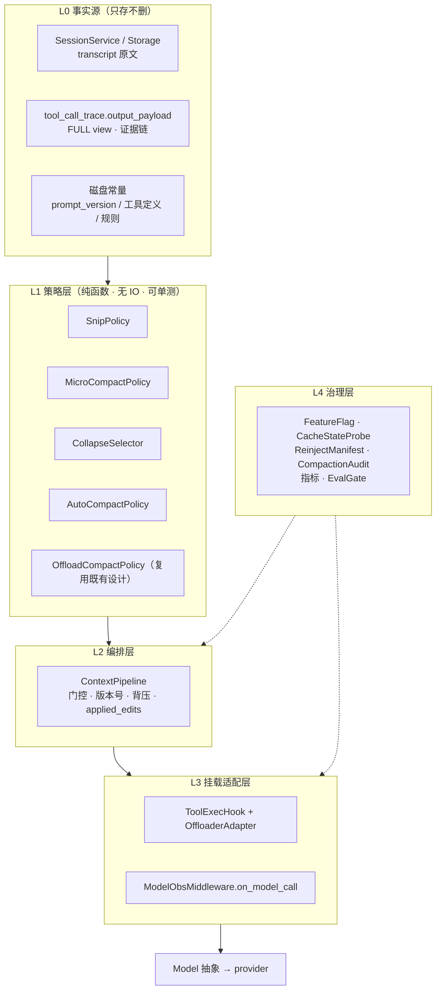
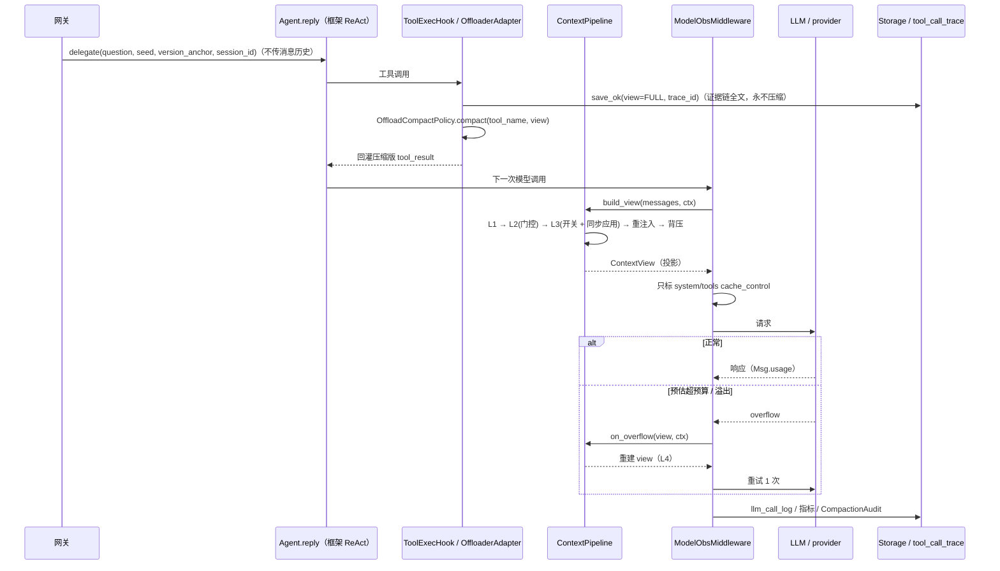

# Agent 上下文压缩管线 实现说明

> **定位**：本文是 [Agent上下文压缩分层-市面对照与演进记录.md](../AGENT服务/Agent上下文压缩分层-市面对照与演进记录.md)（下称《演进记录》）**档 0 / 档 1 的落地实现说明**，自包含覆盖架构分层、模块与接口清单、框架 API 边界、数据模型、配置、指标、评测门禁、探针脚本与分阶段验收。本文是**实现层事实源**；"为什么这样分层、市面对照、档 0/1/2 取舍"以《演进记录》为准，不在本文重复论证。
>
> **与既有文档的关系（避免重复 / 越权）**：
>
> | 文档 | 关系 |
> |---|---|
> | [演进记录](../AGENT服务/Agent上下文压缩分层-市面对照与演进记录.md) | **上层输入**。本文实现其 §4 映射表、§6 档 0/档 1；档 2（服务端会话保持 / 模型主动折叠 / 换框架）**不在本文实现范围**，需单独 ADR |
> | [Agent记忆系统-设计与实现方案.md](../AGENT服务/Agent记忆系统-设计与实现方案.md) §4 / §10 | M2 上下文窗口记忆的**总体设计**与落地状态清单，本文不改变其"模型看摘要、trace 落全文"双路；`history_rehydration_policy` 仍按原设计 |
> | [AgentToken成本优化-设计与实现方案.md](../AGENT服务/AgentToken成本优化-设计与实现方案.md) §6 / §7 / §11 | prompt cache 分层、`OffloadCompactPolicy`、指标命名规范与 `llm_call_log` 字段的**事实源**。本文新增指标与字段属"提议扩展"，必须先同步回该事实源（§7、§8.1） |
> | [Agent可观测性-设计与实现方案.md](../AGENT服务/Agent可观测性-设计与实现方案.md) §5.1 / §8.1 / §13.1 | 指标命名规范、`llm_call_log` 现役字段、评测门禁的事实源 |
> | [Agent路由与多轮上下文-市面对照与演进方向.md](../AGENT服务/Agent路由与多轮上下文-市面对照与演进方向.md) | 分工：该文管 **M0 对话侧记忆 / 路由**，本文管**执行侧喂模型前的压缩管线** |
> | [Agent上下文管理-面试闪光点与答辩话术.md](../面试指南/Agent上下文管理-面试闪光点与答辩话术.md) | 面试侧展开，与实现无关 |
> | [00-架构决策记录ADR.md](../架构设计v2/00-架构决策记录ADR.md) | ADR-01（框架边界）、ADR-04（写闸门）、ADR-10（`EvalRunner` 自建）、ADR-13（自建 `ToolOffloadMiddleware`） |
>
> **适用边界**：仅覆盖 **Python Agent 侧（AgentScope 2.0）**的上下文压缩管线；MES 主体三大 Java 服务与 `实现说明/基础设施/` 目录的中间件配置族不在本文范围。网关侧契约沿用 [Agent入口网关-意图路由.md](../AGENT服务/Agent入口网关-意图路由.md)：`delegate(question, seed, version_anchor, session_id)`，**网关不传消息历史**。
>
> **底座口径**：AgentScope 2.0（pin `2.0.11`，Python 版本要求见 ADR-01）。框架**不提供** `compact` / `Handoffs` / `Routing` / `Pipeline` / `MsgHub` / `agentscope.evaluate`；`Offloader` / `ToolOffloadMiddleware` 为已核实能力名但多在 `app.*` 下划线私有路径，**必须包适配层**。本文所有 `ContextPipeline` / `XxxPolicy` / `XxxHook` 均为**本项目自定义应用层组件，不是框架 API**。
>
> **实现状态**：📐 **设计目标，代码尚未落地**。本文出现的 `app/**` 路径一律为**设计目标路径（当前代码仓不存在）**，与仓库既有设计方案口径一致。所有阈值标 🔴 **待实测**，不得当作已拍板配置。

---

## 0. 口径纪律

1. **不编线上实绩**：本文所有阈值、命中率、节省比例均为"设计目标 + 假设"，沿用 [项目亮点与指标卡片.md](../面试指南/项目亮点与指标卡片.md) §0 与 [AgentToken成本优化-设计与实现方案.md](../AGENT服务/AgentToken成本优化-设计与实现方案.md) 文首纪律。
2. **不把内部封装当框架 API**：`OffloadCompactPolicy` / `ToolExecHook` / `CacheControl` / `ModelObsMiddleware` / `EvalGate` / `ContextPipeline` 全是项目自定义；`ResultCompactor` 是**被替换的旧名**，现役接口是 `OffloadCompactPolicy.compact(tool_name, view)`。
3. **不推算拿不到的数**：`Msg.usage` 现役只有 `input_tokens` / `output_tokens`；`cache_read_tokens` / `cache_creation_tokens` provider 不回传就留 `NULL`，禁止按字符数估算后冒充缓存命中（成本方案 §11.1）。
4. **版本边界**：四层名称、阈值、特性开关、Session Memory 是否存在均属市面特定版本实现观察；本文只借用**分层原则**，不实现某一版本的固定行为（《演进记录》§8）。
5. **先流程正确，后降本有效**：先用确定性假模型 + 全文直喂跑通流程，再启用压缩与缓存，两者解耦分阶段（记忆系统 §10）。

---

## 1. 设计目标与总体判断

### 1.1 一句话结论

> **AgentScope 2.0 没有任何 `compact()` API 可调。要实现《演进记录》的四层按需压缩，框架只提供两个挂钩点（工具结果回灌、模型调用链），其余约 90% 是一条应用层"上下文视图管线"：产出一份本轮要发给模型的消息投影，绝不改写框架 Storage 里的原始 transcript。**

这是本文全部设计的地基，也对应《演进记录》§1.2 的"视图 / 记录分离"。

### 1.2 目标与非目标

| 目标 | 非目标 |
|---|---|
| 按成本递增实现 L1–L4 独立门控 | 复刻 Claude Code 的某个版本行为 |
| 保证 `tool_use` / `tool_result` 配对不被破坏 | 让压缩改写 `tool_call_trace` / transcript |
| 压缩可与 prompt cache 共存、可观测、可归因 | 引入新框架、新 MQ、Celery 或 agent 侧挂起续跑 |
| 压缩质量可回归、可被 `EvalGate` 拦下 | 用压缩省掉版本锚点、证据链、写闸门 |
| 档 0 低风险落地，档 1 可平滑叠加 | 在本方案里拍板档 2 |

### 1.3 三条不可动摇的约束

1. **结构完整性**：清旧工具结果时只替换 `tool_result.content`，**不删除块、不动配对的 `tool_use`**——这是请求合法性底线。
2. **事实源单一**：transcript 归框架 `SessionService` / Storage；FULL view 归 `tool_call_trace.output_payload`；三张新表（§7）只存视图产物的元数据与摘要，不存原始消息全文。
3. **缓存对齐**：缓存状态是"何时压"的门控输入，不是事后优化；固定工具集 + 缓存命中优于动态裁剪 + 缓存未命中。

---

## 2. 总体架构

### 2.1 五层分层



| 层 | 职责 | 落地形态 |
|---|---|---|
| L0 | 存原始事实，永不删除 | 框架 `SessionService` / `AsyncSQLAlchemyStorage`（**不自建 transcript 表**）；`tool_call_trace` 落 FULL view |
| L1 | 各层判定与替换，纯函数 | `app/infrastructure/context/policies/`（设计目标路径） |
| L2 | 门控顺序、`transcript_rev`、背压、清理量回报 | `ContextPipeline` |
| L3 | 把管线接到框架仅有的两个挂钩点 | 复用 `app/infrastructure/ai/tool_exec_hook.py`；扩展 `app/infrastructure/obs/llm_obs.py` |
| L4 | 开关、缓存探测、重注入清单、审计、指标、评测 | `app/infrastructure/context/` + 可观测性事实源 |

### 2.2 目录结构（设计目标路径）

```text
app/
├── infrastructure/
│   ├── context/                              # 新增：本文主体
│   │   ├── view.py                           # ContextView / AppliedEdit / MessageRef
│   │   ├── pipeline.py                       # ContextPipeline（编排 + 溢出重试）
│   │   ├── config.py                         # ContextPolicyConfig（Pydantic）
│   │   ├── cache_state.py                    # CacheStateProbe
│   │   ├── reinject.py                       # ReinjectManifest（压缩后重建工作集）
│   │   ├── backpressure.py                   # BackpressureGuard
│   │   ├── audit.py                          # CompactionAudit
│   │   ├── flags.py                          # FeatureFlag
│   │   ├── policies/
│   │   │   ├── snip.py                       # L1
│   │   │   ├── micro_compact.py              # L2
│   │   │   ├── collapse.py                   # L3（Selector + apply_ready）
│   │   │   ├── auto_compact.py               # L4
│   │   │   └── digest_schema.py              # 折叠 / 兜底摘要结构化 schema
│   │   ├── stores/
│   │   │   ├── collapse_store.py             # CollapseStore（异步产物）
│   │   │   └── session_memory.py             # SessionMemoryStore（L4 优先路径）
│   │   └── adapter/
│   │       ├── offloader_adapter.py          # 包框架私有路径
│   │       └── model_context_middleware.py   # on_model_call 挂载
│   ├── cost/result_compactor.py              # 复用：OffloadCompactPolicy（既有设计）
│   ├── ai/tool_exec_hook.py                  # 复用：唯一取数通道（既有设计）
│   └── obs/llm_obs.py                        # 扩展：ModelObsMiddleware（既有设计）
scripts/
└── probe_agentscope_api.py                   # 新增：Step 0 API 探针（附录 A）
tests/
├── unit/context/                             # 新增：策略纯函数单测
└── eval/context_compaction_cases.yaml        # 新增：压缩前后对照评测用例
```

### 2.3 核心数据类型

```python
# app/infrastructure/context/view.py
from dataclasses import dataclass, field

@dataclass(frozen=True)
class AppliedEdit:
    layer: str                      # snip / micro_compact / collapse / auto_compact
    action: str = "applied"         # applied / skipped / retried
    cleared_blocks: int = 0
    cleared_tokens: int | None = None      # 估算口径须与 provider 对齐，拿不到留 None
    skipped_reason: str | None = None      # cache_warm / below_clear_at_least / rev_mismatch ...

@dataclass
class ContextView:
    messages: list                  # 本轮发模型的投影（框架 Msg / Content Block）
    transcript_rev: int             # 折叠产物与竞态校验的版本号
    applied: list[AppliedEdit] = field(default_factory=list)

    def replace_tool_result(self, idx: int, placeholder: dict) -> None:
        """只替换 tool_result 的 content；绝不删除块、绝不动配对的 tool_use。"""
        ...
```

> `ContextView` 是**投影**，`transcript_rev` 由会话当前消息数 / 最后消息 id 派生（实现取一即可，须单调递增）；所有策略都返回新 `ContextView`，不原地改写 L0。

---

## 3. 三类 API 边界（"到底调哪些 API"）

### 3.1 框架侧（已核实名字，签名待探针确认）

| 用途 | 名字 | 口径 |
|---|---|---|
| 装配 Agent | `Agent(name=, model=, toolkit=, offloader=)` | 逐字核实过的入参**只有这 4 个**；`sessions` / `permission` / `max_steps` 是仓库装配层写法，别当框架关键字 |
| 工具结果卸载 / 回灌 | `Offloader` + `ToolOffloadMiddleware` | 已核实能力名，多在 `app.*` 私有路径 → 必须包 `OffloaderAdapter`；框架公开导出仅 `create_app` / `SubAgentTemplate` |
| 工具执行钩子 | `Toolkit` 工具执行回调 → `ToolExecHook` / `ToolObsMiddleware` | **项目自定义**，非框架 API |
| 模型调用链 | `Model` 抽象 + `ModelObsMiddleware.on_model_call(next_call, messages, **kw)` | 缓存标记与观测在**同一条链**生效（成本方案 §6.1.2） |
| token 口径 | `Msg.usage.input_tokens` / `output_tokens` | 缓存 token 字段**不是框架现役字段** |
| 会话 / 存储 | `SessionService` / `AgentState` / `AsyncSQLAlchemyStorage` | 消息历史归框架 Storage；`message_bus` 目前只有 Redis 实现 |
| 观测 / 权限 / 装配 | `TracingMiddleware`、`PermissionEngine`、`create_app` lifespan | 挂载时机随应用启动装配 |

> ⚠️ 仓库**没有任何框架级"注册 Middleware"的写实写法**（无 `middleware=[...]` / `add_middleware`）。所有 `on_model_call` / `on_tool_call` 签名都自我声明为"本项目封装、非框架 API、尚未接线"。**Step 0 探针核实前，不得把文档伪代码当可 import 源码**。

### 3.2 Provider 侧（可选，且与自研 L1/L2 互斥）

仅当模型走 Claude 系 provider 时，平台已把 L1/L2 做成服务端能力：

```python
# 形状示意：Anthropic Messages API / Bedrock 同类参数（第三方，非本仓库依赖）
betas = ["context-management-2025-06-27"]
context_management = {"edits": [{
    "type": "clear_tool_uses_20250919",
    "trigger": {"type": "input_tokens", "value": 30000},
    "keep": {"type": "tool_uses", "value": 3},
    "clear_at_least": {"type": "input_tokens", "value": 5000},
    "exclude_tools": ["trace_lookup"],
    # clear_tool_inputs 默认 False：只清结果、保留原始工具调用
}]}
# 另有 clear_thinking_20251015、memory_20250818、
# cache_control={"type":"ephemeral"}（只标 system/tools）、
# tool_search_tool_regex + defer_loading: true、message threads beta
```

**决策**：项目 `Model` 抽象可插拔（默认 `DashScopeChatModel`），且压缩策略要受 `EvalRunner` / 证据链约束 → **主路径用自研管线**；平台侧只作为"Claude provider 专用适配分支"评估。由 `FeatureFlag("provider_context_editing")` 与自研 L1/L2 开关**互斥校验**，两边同时清会重复清理并互相打断缓存。

### 3.3 自研侧（本项目真正要调用的 API）

| 接口 | 作用 | 层 |
|---|---|---|
| `ContextPipeline.build_view(messages, ctx) -> ContextView` | 请求前组装视图，跑 L1/L2/L3 门控 + 重注入 + 背压 | L2 |
| `ContextPipeline.on_overflow(view, ctx) -> ContextView` | 溢出后 L4 压缩 + 重建，供重试 | L2 |
| `SnipPolicy.apply(view, ctx)` | L1 纯函数替换 | L1 |
| `MicroCompactPolicy.should_run(ctx)` / `apply(view, ctx)` | L2 门控与清理 | L1 |
| `CollapsePreparer.prepare(segment)`（后台异步）/ `CollapseStore.get_ready(rev)`（请求前同步） | L3 异步准备 + 同步应用 | L1 / stores |
| `AutoCompactService.compact(view, ctx)` | L4 两级策略 | L1 |
| `ReinjectManifest.apply(view, ctx)` | 压缩后从磁盘重建工作集 | L4 |
| `CacheStateProbe.is_cold(ctx)` / `BackpressureGuard.check(view)` / `CompactionAudit.record(edits, ctx)` | 门控与治理 | L4 |
| `OffloadCompactPolicy.compact(tool_name, view) -> dict` | **复用既有设计** | L1 |

### 3.4 API 探针（Step 0 必做）

```python
# scripts/probe_agentscope_api.py（新增；输出存档为附录 A 的填写依据）
import importlib, inspect
import agentscope
from agentscope.agent import Agent

print("agentscope", agentscope.__version__)
print("Agent.__init__", inspect.signature(Agent.__init__))

CANDIDATES = [
    ("agentscope.offloader", "Offloader"),
    ("agentscope.middleware", "ToolOffloadMiddleware"),
    ("agentscope.session", "SessionService"),
    ("agentscope.model", "Model"),
    ("agentscope.message", "Msg"),
]
for path, name in CANDIDATES:
    try:
        mod = importlib.import_module(path)
        obj = getattr(mod, name)
        print("OK", path, name, inspect.signature(obj))
    except Exception as e:
        print("UNVERIFIED", path, name, type(e).__name__, str(e))
```

探针需回答四个问题（填 Appendix A）：① `Agent.__init__` 真实签名；② `Offloader` / `ToolOffloadMiddleware` 的真实导入路径与构造参数；③ 自定义 Middleware 如何注册到 Model 调用链；④ `AsyncSQLAlchemyStorage` 是否在 `2.0.11` 源码树内、DDL 方言为何。CI 加一条 API 漂移检查（pin 版本 + 探针输出比对）。

---

## 4. 模块与接口清单

### 4.1 编排层

```python
# app/infrastructure/context/pipeline.py
class ContextPipeline:
    def __init__(self, snip, micro, collapse, auto, reinject,
                 cache_probe, backpressure, audit, flags, config): ...

    async def build_view(self, messages, ctx) -> ContextView:
        view = ContextView(messages=list(messages), transcript_rev=ctx.transcript_rev)

        view = self._snip.apply(view, ctx)                       # L1：几乎无条件、纯函数

        if self._micro.should_run(ctx):                           # L2：时间 + 缓存状态门控
            view = self._micro.apply(view, ctx)
        else:
            view.applied.append(AppliedEdit("micro_compact", "skipped",
                                            skipped_reason="cache_warm"))

        if (self._flags.enabled("collapse")
                and self._collapse.has_stable_segments(view, ctx)):   # L3：多一道特性开关
            view = await self._collapse.apply_ready(view, ctx)    # 同步取最新、校验 rev

        view = self._reinject.apply(view, ctx)                    # 档0②：常量重注入
        view = self._backpressure.check(view, ctx)                # 高压限制扩张
        self._audit.record(view.applied, ctx)                     # applied_edits 回报
        return view

    async def on_overflow(self, view, ctx) -> ContextView:
        return await self._auto.compact(view, ctx)                # L4 + 单次重试由调用方控制
```

### 4.2 L1 Snip（纯函数）

- 门控：`keep_last_tool_pairs` / `exclude_tools` / `min_result_tokens`。
- 动作：`replace_tool_result(idx, placeholder)` 替换为短标记；占位必须带 `__truncated__` 语义（与 `OffloadCompactPolicy` 的 `_truncated` / `_omitted_count` 风格一致），让模型知道数据不全。
- 不变量（单测断言）：块数不变、`tool_use_id` 一一对应、`exclude_tools` 结果未动、最近 N 对未动。

### 4.3 L2 MicroCompact（缓存对齐）

```python
def should_run(self, ctx) -> bool:
    return (ctx.now - ctx.last_compact_at >= self._cfg.min_interval_s
            and (not self._cfg.require_cache_cold or self._cache.is_cold(ctx)))
```

- `CacheStateProbe.is_cold()` **只能用可观测事实**：上次模型请求时间、`promptCacheTtl` 配置（5m / 1h 桶）、`llm_call_log` 中可取得的 token 值；**不得**依赖不存在的 `usage.cache_read_tokens`。
- `clear_at_least`：预估可清 token 低于阈值就整层跳过，记 `skipped_reason="below_clear_at_least"`——把缓存失效成本显式纳入决策。
- 保留近期结果；`exclude_tools` 与 L1 共用配置。

### 4.4 L3 Collapse（异步准备 + 同步应用）

| 组件 | 职责 | 约束 |
|---|---|---|
| `CollapseSelector` | 选中段**稳定、低风险**片段：已结束、无未决引用、不与当前任务交错；只压中段，头（系统/初始意图）尾（近期工作集）不动 | 纯函数 |
| `CollapsePreparer` | 后台用框架的**另一个 `Agent` 实例**（干净上下文、只读）生成 `CollapseDigest` | 只在**无在途请求**时启动；不得污染主上下文 |
| `CollapseStore` | 按 `(session_id, segment_hash, transcript_rev)` 存 `READY` / `STALE` / `FAILED` | 只存摘要，不存原文 |
| `apply_ready()` | 请求前**同步**取最新、校验 `transcript_rev`、替换进 `ContextView` | rev 不一致 → 跳过折叠并记 `skipped_reason="rev_mismatch"`，**绝不用过期摘要** |
| `BackpressureGuard` | 上下文压力高时限制继续派生新分支 / 新任务 | 避免"边压边灌" |

### 4.5 L4 AutoCompact（两级兜底）

```text
compact(view, ctx):
  1) SessionMemoryStore.get(session_id, rev) → 已有结构化摘要 + 近期原文
     （后台持续维护，触发时零额外 LLM 调用）
     ├─ 命中 → 组装 view，记 action=applied, source=session_memory
     └─ 不适用 / 失败 → 2
  2) FullCompact：调模型生成结构化摘要（schema 见 Appendix C）
     记 action=applied, source=full_llm_compact
  3) 调用方以新 view 重试请求，max_retry = 1（禁止无限重试）
```

触发：请求前预估超预算，或 provider 返回上下文溢出。前者属预防，后者属**请求后**路径。

### 4.6 压缩后重建（`ReinjectManifest`，档 0②）

| 内容 | 压缩后 | MES 侧对应 |
|---|---|---|
| System prompt / output style | 继续生效 | 系统提示词、`prompt_version` |
| 项目规则 / 能力装配说明 | **从磁盘重注入** | 租户、能力清单、路由说明 |
| Auto memory / 锚点 | **从磁盘重注入** | `session_id` / `seed` / `version_anchor` |
| 工具定义 / skill 描述 | 按当前装配重建 | `Toolkit` 静态定义 |
| 带作用域的规则 | 按触发条件**按需重载** | 版本锚点、写闸门说明 |
| 读 / 编辑过的文件 | 按最近修改顺序重读最多 `max_reread_files`；超 `single_file_token_cap` 只留路径引用 | 追溯证据按需取回 |
| 后台任务 / 子 Agent | 继续运行，并提醒模型别重复起一个 | 子会话状态 |

> **原则**：压缩 ≠ 把历史换成一段文本，而是一次受预算约束的**工作集重建**；磁盘是常量事实源，摘要只承载变量部分。别把配置当历史来压缩。

---

## 5. 调用链与时序



全程 **transcript 与 `tool_call_trace` 一行未改**；变的是 `ContextView`。

### 5.1 挂载适配层（代码示例）

```python
# app/infrastructure/obs/llm_obs.py —— 扩展既有 ModelObsMiddleware
class ModelObsMiddleware:
    async def on_model_call(self, next_call, messages, **kw):
        view = await self._pipeline.build_view(messages, self._ctx)   # 视图投影
        messages = view.messages
        if self._cache is not None:                                   # 只标 system / tools
            messages = [mark_system_prompt_cache(m, self._cache.ttl) if is_system(m) else m
                        for m in messages]
            kw["tools"] = mark_tools_cache(kw.get("tools", []), "1h")
        resp = await next_call(messages, **kw)
        self._obs.llm_called(prompt_tokens=resp.usage.input_tokens,
                             completion_tokens=resp.usage.output_tokens, ...)
        return resp
```

```python
# app/infrastructure/ai/tool_exec_hook.py —— 复用「唯一取数通道」
async def run(self, call, ctx) -> dict:
    view_full = await self._acl.get_or_compute(tool, call.args, ctx)      # FULL view
    trace_id = await self._trace_repo.save_ok(..., view=view_full, ...)   # 证据链落全文
    compacted = self._policy.compact(tool.name, view_full)                # 只压喂模型一路
    return {"trace_id": trace_id, "data": compacted}                      # 交给 Offloader
```

> **退路**：若探针发现框架 Middleware 注册机制与仓库骨架不一致，把 `ContextPipeline` 包进项目自己的 `Model` 适配层（`Agent(model=...)` 注入），接口形状保持 `build_view(messages, ctx)` 不变，将来可平移回 Middleware 链——**不依赖 `app.*` 私有注册 API**。

### 5.2 平台侧与自研侧的互斥

```python
# app/infrastructure/context/config.py 启动时校验
if flags.enabled("provider_context_editing") and config.snip.enabled:
    raise ConfigError("provider context editing 与自研 L1/L2 必须二选一")
```

---

## 6. 配置

```yaml
# app/infrastructure/context/config.py（Pydantic；全部 🔴 待实测，均为起步值）
context:
  enabled: true
  budget_tokens: 40000            # 对齐 [研究报告生成 flow](../AGENT服务/FactoryAgent/FactoryAgent-研究报告生成flow.md) §7「父会话 40~50k 触发压缩/卸载」
  snip:
    enabled: true
    keep_last_tool_pairs: 3
    exclude_tools: [trace_lookup, write_action]
    min_result_tokens: 500
  micro_compact:
    enabled: true
    min_interval_s: 300
    require_cache_cold: true
    clear_at_least_tokens: 5000
  collapse:
    enabled: false                # 特性开关，默认关（档 1 才评估）
    max_segment_tokens: 8000
    idle_only: true
  auto_compact:
    trigger_ratio: 0.85
    max_retry: 1
    session_memory_first: true
  reinject:
    max_reread_files: 5
    single_file_token_cap: 5000
  provider_context_editing:
    enabled: false                # 与 snip/micro_compact 互斥
```

- 开关统一走 `FeatureFlag`，`collapse.enabled=false` 是默认态——**Collapse 取决于特性是否启用，不是固定行为**。
- `prompt_version` 与裁剪规则任一变更 → 触发 `EvalRunner` 回归（§10）。
- `CURRENT` 数据范围一律跳过答案缓存；`data_scope` 只由 `as_of` 派生（时变性红线）。

---

## 7. 数据模型

> ⚠️ 以下是**字段清单 / 方言无关伪 DDL**。项目实际存储选型（框架 `AsyncSQLAlchemyStorage` 对应库）由 Step 0 探针确认后再落正式 DDL；本节全部是**本篇提议扩展**，落地前须同步回 [AgentToken成本优化-设计与实现方案.md](../AGENT服务/AgentToken成本优化-设计与实现方案.md) §11 与 [Agent可观测性-设计与实现方案.md](../AGENT服务/Agent可观测性-设计与实现方案.md) §8.1 事实源，避免出现"两处简版各说各话"。

### 7.1 现有表字段扩展

```sql
-- llm_call_log 现役字段（可观测性 §8.1 / §13.1）：
--   call_id / session_id / step_no / model / prompt_version
--   prompt_token_count / completion_token_count / latency_ms / finish_reason
--   tool_calls_produced / occurred_at
--   prompt 全文不落库，只落摘要 + prompt_version
llm_call_log
  + compacted_input_tokens   INT NULL      -- 压缩后输入 token（成本方案 §11.1 已提议）
  + transcript_rev           INT NULL      -- 本轮视图版本，便于回放
  + cache_read_token_count   INT NULL      -- provider 回传才有值，拿不到留 NULL，禁止推算
  + cache_write_token_count  INT NULL      -- 同上

-- tool_call_trace：不新增压缩相关字段；output_payload 必须是压缩前 FULL view
```

### 7.2 新增表（只存视图产物元数据，不存原始消息全文）

```sql
-- ① 每次压缩动作的审计与 applied_edits 回报
context_compaction_log
  - id                BIGINT PK
  - tenant_id         VARCHAR(64)  NOT NULL
  - session_id        VARCHAR(64)  NOT NULL
  - trace_id          VARCHAR(64)  NULL
  - step_no           INT          NOT NULL
  - transcript_rev    INT          NOT NULL
  - layer             VARCHAR(24)  NOT NULL   -- snip/micro_compact/collapse/auto_compact
  - action            VARCHAR(24)  NOT NULL   -- applied/skipped/retried
  - skipped_reason    VARCHAR(64)  NULL       -- cache_warm/below_clear_at_least/rev_mismatch
  - cleared_blocks    INT          DEFAULT 0
  - cleared_tokens    INT          NULL       -- 估算口径须与 provider 对齐
  - input_tokens_after INT         NULL
  - prompt_version    VARCHAR(64)  NULL
  - occurred_at       DATETIME(3)  NOT NULL
  - INDEX (tenant_id, session_id, step_no), INDEX (layer, occurred_at)

-- ② L3 折叠摘要产物（后台异步写、请求前同步读）
context_collapse_digest
  - id                BIGINT PK
  - tenant_id         VARCHAR(64)  NOT NULL
  - session_id        VARCHAR(64)  NOT NULL
  - segment_hash      VARCHAR(64)  NOT NULL
  - transcript_rev    INT          NOT NULL
  - start_msg_id      VARCHAR(64)  NOT NULL
  - end_msg_id        VARCHAR(64)  NOT NULL
  - digest_json       JSON         NOT NULL   -- 结构化局部摘要，不含原文
  - prompt_version    VARCHAR(64)  NULL
  - state             VARCHAR(16)  NOT NULL   -- READY / STALE / FAILED
  - created_at        DATETIME(3)  NOT NULL
  - expires_at        DATETIME(3)  NULL
  - UNIQUE (tenant_id, session_id, segment_hash, transcript_rev)

-- ③ L4 优先路径：后台维护的会话摘要
context_session_memory
  - tenant_id         VARCHAR(64)  NOT NULL
  - session_id        VARCHAR(64)  NOT NULL
  - rev               INT          NOT NULL
  - summary_json      JSON         NOT NULL   -- 六段式 + 已排除路径（Appendix C）
  - recent_window_ref VARCHAR(255) NULL      -- 指向框架 Storage 的近期消息范围，不复制原文
  - source            VARCHAR(24)  NOT NULL   -- BACKGROUND / FULL_COMPACT
  - prompt_version    VARCHAR(64)  NULL
  - updated_at        DATETIME(3)  NOT NULL
  - expires_at        DATETIME(3)  NULL
  - PRIMARY KEY (tenant_id, session_id)
```

**明确不新建**：transcript 表（归框架 Storage）、原始消息全文表、`MsgHub` 状态表。`recent_window_ref` 只引用框架 Storage 的 id 范围，不双写事实源。

### 7.3 租户隔离

三张表均带 `tenant_id` + `session_id` 复合隔离键，且**必须**在仓储层强制带上 `tenant_id`（与 `tool_call_trace` / `llm_call_log` 同一隔离口径）；折叠子 Agent 与 Session Memory 的读写入口统一走 `get_session(tenant_id, session_id)`，禁止跨租户 hit（CTX-15）。🔴 租户字段是否已在框架 `agent_sessions` 中现役，待 Step 0 探针确认。

---

## 8. 可观测与指标

### 8.1 新增指标（须先过可观测性 §5.1 命名规范评审）

| 指标 | 类型 | label | 含义 |
|---|---|---|---|
| `agent_context_cleared_token_total` | Counter | layer, capability | `applied_edits` 清理量估算（Counter 避免 Histogram 后缀违规） |
| `agent_context_cleared_block_total` | Counter | layer, tool | 被替换的 tool_result 块数 |
| `agent_context_layer_skipped_total` | Counter | layer, reason | 门控跳过次数（含 `cache_warm` / `rev_mismatch`） |
| `agent_context_view_token_ratio` | Gauge | capability | 压缩后 / 压缩前 token 比 |
| `agent_compact_retry_total` | Counter | status | L4 兜底重试次数（>1 即告警） |
| `agent_collapse_digest_stale_total` | Counter | capability | 折叠摘要版本不一致被丢弃次数 |

固定 label 沿用 `capability` / `tool` / `status` / `model` / `bounded_context`；**新增 `layer` / `reason` label 需评审**（成本方案 §11.2 同款纪律）。`CURRENT` 请求不进缓存命中率分母。所有指标落地前先在可观测性事实源登记。

### 8.2 日志与追踪

- 每次 `build_view` 输出一条结构化日志：`session_id` / `trace_id` / `step_no` / `transcript_rev` / 各层 `action` / `cleared_tokens` / `input_tokens_after`；**不落 prompt 全文**。
- `TracingMiddleware` 的 trace 事件作为过程数据供 `EvalRunner` 复盘；不引入第二套追踪。
- 缓存 miss 原因命名（如 `likely cause: tool definitions changed`）属档 1 增强，🔴 待实测，档 0 只记 `applied_edits`。

---

## 9. 评测门禁与测试用例

### 9.1 门禁链路

```text
压缩策略 / 裁剪白名单 / 折叠 prompt / 摘要 schema 任一变更
  → 自建 EvalRunner（三层判定：程序化断言 / 指标阈值 / LLM-as-judge，judge 用 py-openjudge）
  → 压缩前后对照：hard gate 安全断言全过 + pass^k / 根因准确率不退 + token 下降
  → shadow（100% 复制真实任务但无副作用）→ canary → 放量
  → 不通过则不上线（质量红线 > 成本）
```

- 安全 **hard gate** 零容忍：版本锚点、写越界、租户越权、过点侵入、PII、实体幻觉、证据空、`stale_fact_rate = 0`（成本方案 §10.3）。
- `pass^k`（k=8 口径）、每成功任务成本、ECE <0.1 沿用既有评测主轴。
- **压缩专项**：新增"压缩前后对照用例集"，判 **recall 优先**——关键事实、版本锚点、`trace_id`、已排除路径任一丢失即失败；precision 调优放到 recall 达标之后。

### 9.2 测试用例清单（节选）

| ID | 层 | 场景 | 断言 |
|---|---|---|---|
| CTX-01 | L1 | 大块工具结果替换 | 块数不变；`tool_use_id` 一一对应；`__truncated__` 标记存在 |
| CTX-02 | L1 | `exclude_tools` 命中 | 该工具结果字节不变 |
| CTX-03 | L1 | 最近 N 对结果 | 全部保留 |
| CTX-04 | L2 | 缓存温热 | `should_run=False`，日志有 `cache_warm` |
| CTX-05 | L2 | 缓存已冷但可清量 < `clear_at_least` | 整层跳过，记 `below_clear_at_least` |
| CTX-06 | L3 | 特性开关关闭 | 不触发折叠、不查 `CollapseStore` |
| CTX-07 | L3 | 摘要 `rev` 落后 | 跳过折叠，记 `rev_mismatch`，原文视图完整 |
| CTX-08 | L3 | 空闲期有在途请求 | `CollapsePreparer` 不启动 |
| CTX-09 | L4 | Session Memory 命中 | 零额外 LLM 调用，`source=session_memory` |
| CTX-10 | L4 | Session Memory 失败 | 走 `FullCompact`，摘要含六段式字段 |
| CTX-11 | L4 | 溢出重试 | 最多重试 1 次，第二次失败上抛 |
| CTX-12 | 横切 | 压缩后重建 | 常量来自磁盘；重读文件数 ≤ `max_reread_files` |
| CTX-13 | 红线 | 压缩前后对照 | `tool_call_trace.output_payload` 字节一致；FULL view 未变 |
| CTX-14 | 红线 | `CURRENT` 请求 | 不写答案缓存；`data_scope` 仅由 `as_of` 派生 |
| CTX-15 | 红线 | 跨租户 | 折叠摘要 / Session Memory 不可跨 `tenant_id` 命中 |

> `agentscope.evaluate` 在 2.0 已删除未回归，评测栈一律自建（ADR-10）；`TracingMiddleware` 只提供过程数据。

---

## 10. 分阶段实施与验收

| Step | 内容 | 对应档 | 完成判据 |
|---|---|---|---|
| **0** | `probe_agentscope_api.py`：核实框架真实签名、Middleware 注册方式、Storage 方言；CI 加 API 漂移检查；填写 Appendix A | 前置 | Appendix A 四项全部有实测结论，无 `UNVERIFIED` |
| **1** | L1 `SnipPolicy` + `ContextView`（纯函数） | 档 0① | CTX-01/02/03 全绿；未改 Storage |
| **2** | `OffloaderAdapter` + `OffloadCompactPolicy` + `ToolExecHook` 落 FULL view | 档 0① | 假模型跑通"模型看摘要、trace 落全文"；CTX-13 |
| **3** | L2 门控 + `CacheStateProbe` + `applied_edits` 与指标登记 | 档 0① | CTX-04/05；指标已写入可观测性事实源 |
| **4** | `ReinjectManifest` 压缩后重建 + `/recap` 式"只读摘要不替换历史" | 档 0② | CTX-12；压缩后缓存前缀未被替换 |
| **5** | 评测门禁：压缩前后对照用例集 + recall 优先 | 档 0 | 裁掉关键字段即被 `EvalRunner` 拦下；CTX-14/15 |
| **6** | L4 兜底（`SessionMemoryStore` → `FullCompact`）+ 溢出重试 | 档 0 | CTX-09/10/11；阈值 🔴 待实测 |
| **7** | 空闲期压缩调度、外部化记忆（只存锚点/意图/已排除路径）、渐进式披露、摘要加"死路" | 档 1 | 需调度器 + 存储 + 租户隔离设计，单独评审 |
| — | 服务端会话保持 / 模型主动折叠 / 换框架 | 档 2 | **不在本文范围，需单独 ADR** |

**硬顺序**：Step 0 未完成不得写正式挂载代码；Step 5 未通过不得启用降本有效性验证（记忆系统 §10）。

### 10.1 上线检查清单

- [ ] 框架版本 pin 在 `2.0.11`，探针输出与 Appendix A 一致
- [ ] `context.collapse.enabled=false` 为默认态
- [ ] `provider_context_editing` 与自研 L1/L2 互斥校验生效
- [ ] 三张新表 `tenant_id` 隔离已实测
- [ ] 新增指标已在可观测性事实源登记
- [ ] 压缩策略 / prompt 变更已过 `EvalRunner` 与 `EvalGate`
- [ ] `tool_call_trace.output_payload` 全量比对无差异
- [ ] 所有阈值标 🔴，配置中心可动态改、无需发版

---

## 11. MES 红线与口径陷阱

1. **压缩只作用于喂模型这一路**：`tool_call_trace.output_payload` 存压缩前 FULL view，`evidence` 只存 `trace_id` 列表；M3 证据链与审计不受任何清理 / 折叠 / 摘要影响。
2. **外部记忆受时变性红线约束**：只记锚点 / 意图 / 已排除路径，不记"根因 = X"；语义缓存默认关闭、`CURRENT` 一律跳过缓存；`data_scope` 只由 `as_of` 派生，即使带 `version` 也不缓存（`LIVE_ONLY`）。
3. **渐进式披露不放松写闸门**：工具 / 技能按需加载只改"看得见什么"，过点红线、写令牌主闸、confirmation gate 一律不变（ADR-04）。
4. **不改 Storage 里的 message history**：视图是投影，transcript 是事实源；折叠可回退全靠这条。
5. **不依赖 `app.*` 私有路径**：一律包适配层；框架公开导出仅 `create_app` / `SubAgentTemplate`。
6. **不算不存在的缓存账**：`Msg.usage` 只有 input/output tokens；拿不到就留 `NULL`。
7. **折叠不用过期摘要**：`transcript_rev` 校验 + 请求前同步应用，不一致就降级为不折叠。
8. **平台侧与自研侧互斥**：避免重复清理、互相打断缓存。
9. **不追大窗口 / 平台特性**：MES 流量以结构化事件 + 界面按钮为主，纯多轮自由对话占比小；"记忆按场景需要才上，不无脑全配"。
10. **不引入新中间件**：不引入 Celery、新 MQ、agent 侧挂起续跑（整体选型 §5 决策 11）。

---

## 12. 开放问题（对齐《演进记录》§7，实施时逐项拍板）

| # | 问题 | 倾向 | 状态 |
|---|---|---|---|
| 1 | 清理门控归 `OffloadCompactPolicy` 还是 Middleware 层统一裁决？与 `prompt_version` 变更如何联动回归？ | 先放策略对象，配 `applied_edits` 回报 | 🔴 待定 |
| 2 | 压缩后"从磁盘重注入"的 MES 常量清单？重读文件上限与 `single_file_token_cap` 如何统一？ | 对齐 flow §7 单次 tool ≤5k | 🔴 待定 |
| 3 | 空闲压缩触发条件：空闲时长 / 缓存 TTL 桶 / 步数预算？前后台并发改写视图如何互斥？ | 无在途请求才启动；发请求前校验 rev | 🔴 待定 |
| 4 | 外部化记忆作用域与 TTL：`session_id` 还是 `user + 车间`？与 M0 对话记忆是否同一组件？ | 分开声明，别混成单体 Memory | 🔴 待定 |
| 5 | `transcript_rev` 用消息数还是最后消息 id 派生？ | 实现取一，须单调递增 | 🔴 待定 |
| 6 | 摘要 schema 的"已排除路径"如何进 `EvalRunner` 断言？ | recall 优先专用断言 | 🔴 待定 |
| 7 | 服务端会话保持（档 2）是否值得？ | 长会话入口成主流量后复评，单独 ADR | 🔴 待评估 |

---

## Appendix A. API 核实记录（Step 0 填写）

| 核实项 | 期望 | 实测结果 | 结论 |
|---|---|---|---|
| `agentscope.__version__` | `2.0.11` | 待填 | 🔴 |
| `Agent.__init__` 签名 | 仅 `name/model/toolkit/offloader` | 待填 | 🔴 |
| `Offloader` 导入路径与构造参数 | 可 import、签名明确 | 待填 | 🔴 |
| `ToolOffloadMiddleware` 注册方式 | 可挂到工具执行 / 回灌链 | 待填 | 🔴 |
| 自定义 Middleware 挂 Model 调用链 | 与观测埋点同一链 | 待填 | 🔴 |
| `AsyncSQLAlchemyStorage` 是否在 2.0.11 树内 / DDL 方言 | 明确库型 | 待填 | 🔴 |
| `Msg.usage` 实际字段 | 仅 input/output tokens | 待填 | 🔴 |

> 若 Middleware 注册方式与仓库骨架不一致 → 启用 §5.1 退路（项目自有 `Model` 适配层），并把结论同步回 [Agent可观测性-设计与实现方案.md](../AGENT服务/Agent可观测性-设计与实现方案.md)。

## Appendix B. L3 折叠摘要 schema

```json
{
  "segment_hash": "...",
  "transcript_rev": 42,
  "start_msg_id": "...",
  "end_msg_id": "...",
  "goal": "这段历史在解决什么",
  "actions": ["做过的关键动作"],
  "artifacts": ["涉及的文件 / trace_id"],
  "conclusion": "结论",
  "unresolved": ["未决引用"],
  "excluded_paths": ["已排除的路径与原因"]
}
```

> 折叠摘要**只回传结构化结论**，不回传原文；`unresolved` 非空时 `CollapseSelector` 不得把该段判为"稳定低风险"。

## Appendix C. L4 Full LLM Compact 摘要 schema

```json
{
  "core_request": "核心请求",
  "files": ["涉及文件"],
  "errors_and_fixes": ["错误与修复"],
  "todos": ["待办"],
  "current_work": "当前工作",
  "next_step": "下一步",
  "excluded_paths": ["已排除路径 / 死路"],
  "version_anchor": "版本锚点",
  "trace_refs": ["trace_id"]
}
```

> 六段式保证**可续接**（下一轮能接着干活），不是概括成一段散文；`excluded_paths` 为《演进记录》§3.7 的档 1 增强字段，档 0 可留空但 schema 先固定。`version_anchor` 与 `trace_refs` 不得因压缩丢失（`EvalRunner` 硬断言）。

---

> **一句话**：本方案落地的不是一次 `compact()` 调用，而是 `ContextPipeline.build_view()` 这条应用层视图管线——框架只提供 `Offloader` / `ToolOffloadMiddleware`（工具结果回灌）与 `Model` 调用链两个挂钩点，四层门控、折叠、兜底、重注入、审计全部自研；**先探针核实 `2.0.11` 真实签名，再按 Step 0→6 推档 0、Step 7 推档 1**，全程让 FULL view 留在 `tool_call_trace`、让 transcript 一个字不改。
